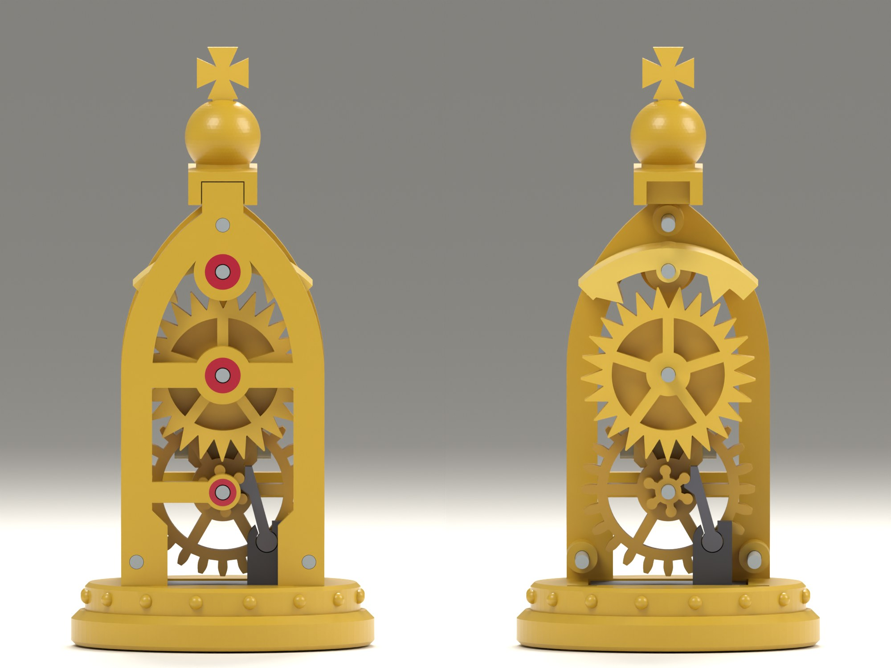

# King: design notes

*First build, 2026-11-14 (fourth session); run model added in the fifth session, the same
day. Model `clockwork_king` 0.1.0, variant `playing`. Modelled and checked in CAD only:
nothing has been printed, so every fit is a starting value.*

**By the run model the king as built does not have enough margin: it ticks if friction is
0.25 or less and stalls on its second beat from 0.26. Printed plastic on printed plastic is
usually taken as 0.2 to 0.4. Section 9 has the figures, section 12 what to do about it.**

## 1. What was built

The king ticks for a few seconds after every move, and then stands still until it is moved
again.

When the king is lifted, a weighted plunger drops 4.0 mm out of its base and a pawl on it
clicks under the next lobe of a small star. Set down, the king falls 0.9 mm onto that pawl
and then sinks the last 3.1 mm under its own weight. The sinking drives a real recoil anchor
escapement with a pendulum: twenty beats per move. The piece that moved last is the one still
ticking, and a tipped king stops.

The client chose the king as the second piece because it has the most room and there are only
two per set ("awesome, let's go for the king!"). This goes one step past `brief.md`, which
gives the king an escapement that is stepped one tooth per move by the plunger. That version
remains the fallback: it uses the same wheel and anchor.

Films: [`img/motion.gif`](img/motion.gif) (one move: lifted, set down, ticking),
[`img/mechanism.gif`](img/mechanism.gif) (the same with the front plate taken off)
and [`img/pendulum.gif`](img/pendulum.gif) (from behind, the rear plate taken off).
The hand's part is drawn. From the moment the king rests on its pawl the films show the run
model in real time, with a friction of 0.2 (section 9): a move takes 2.1 s and the pendulum
swings for 0.7 s more. At twenty frames a second that is two frames to a beat. Other stills
are in `img/`.

## 2. Decisions

The client answered the three decisions of `brief.md`, section 6, on 2026-11-14:

| Decision | Answer |
|---|---|
| Hardware | Steel allowed: pins as arbors, a steel bob on the pendulum |
| Size | Playing size: king base Ø44 mm, matching the knight as built |
| Files or printed sets | Not decided yet: every fit is generous and a named parameter |

## 3. How it works

Side view as on the knight: X to the right, Z up, seen from the front (-Y), arbors along Y.
All three arbors stand on the centre line, one above the other, at 22.6, 39.6 and 54.6 mm
above the board.

1. **Plunger.** A bar in a slot through the base with a steel weight, as on the knight but
   as wide as the piece. A stem rises from its front edge and ends in a socket.
2. **Pawl and star.** The pawl is a strut 10 mm long. Its round knuckle sits in the socket;
   its head has a cup with a straight fence beside it. The star is a small boss with six
   round lobes on stalks, on the front of the great wheel. A lobe lies in the cup like a pin
   in a bearing, so the pawl and the star work as a connecting rod and a crank: the king's
   weight on the star turns it 60° while the king sinks 3.14 mm.
3. **The click.** When the king is lifted the plunger drops. The sloping underside of the
   pawl's head rides over the next lobe and pushes the pawl aside by 9°; below the lobe the
   pawl falls back by its own weight and leans its fence on the lobe's side, with the cup
   right below it. That is what makes the drive one-way.
4. **Great wheel.** 24 teeth, one part with the star. It turns a 10-tooth pinion.
5. **Escape wheel.** 25 pointed teeth, one part with the pinion. It turns 144° per move, which
   is ten teeth.
6. **Anchor and pendulum.** One part. The anchor's two pallets let one tooth pass for every
   two beats. The pendulum hangs behind the wheels: a ring that goes round the escape wheel's
   arbor, and a steel pin as the bob below it.
7. **Stops.** The plunger hangs on two ears. The pendulum's ring stops the anchor 8.5° either
   side. The lips of the socket stop the pawl 6° inwards and 14° outwards of where it stands
   at rest.

One move is exactly 1 lobe of the star, 4 teeth of the great wheel, 4 of the pinion and 10 of
the escape wheel. Every part therefore ends a move looking as it did before it, and the film
of one move loops without a jump.

## 4. What changed from the paper design, and why

The third session ended with a design on paper. Building it changed these points:

| Paper design | As built | Why |
|---|---|---|
| Star with six saw teeth, pawl with a round nose seated at a tooth's foot | Six round lobes on stalks, pawl with a cup | Seated at the foot of a tooth, the pawl pushes almost towards the star's centre at the start of a move: its lever arm was 0.4 to 1.4 mm there against 3.0 mm at the end, too little to start the escapement. Its shank also met the tooth below. A lobe in a cup turns like a hinge: 2.35 to 3.22 mm |
| Stroke 3.2 mm by hand | 3.14 mm computed | The hand figure assumed a hinge, which the saw tooth was not |
| Travel 4.5 mm | 4.0 mm | The pawl is under the next lobe at 3.25 mm, so 4.0 leaves 0.75 mm. Less travel means a shorter free fall |
| Escape wheel 13.0 over the teeth | 12.7 | The star and the escape wheel share a layer and pass each other; 0.5 mm between them |
| Anchor stopped at 11° to 13° by a tooth's flank, hand estimate | Stopped at 8.5° by the ring | On the solids the entry pallet meets a flank at 9.2°. The exit pallet is free past 13° |
| Rear bosses, radius not set | Radius 2.0 | At rest the bob's block stands 0.9 mm above the lower boss, and it comes closer as it swings |
| Nine printed parts, cross on the crown | Ten: the cross is its own flat part | Printed upright its arms would hang in the air |
| Height 83 to 88 mm | 86.7 mm | |

## 5. Parts

Every printed part but the base and the crown is a stack of flat pierced plates and prints
lying down without support.

| Part | Size (mm) | Prints | Notes |
|---|---|---|---|
| `base` | Ø44 × 9.0 | upright | Slot for the plunger, four mortises, sixteen studs |
| `plate_front`, `plate_rear` | 30 × 67 × 3 | outer face down | Gothic window: columns on plinths, a bar across at the escape wheel, a pointed arch and its mullion. Half posts 9 mm high on the inner face; sprung feet |
| `jewel_*` (6) | Ø5.2 × 0.8, one Ø4.0 | with the plate, first layers | Red rings flush in the outer faces; the arbors turn in them |
| `great_wheel` | Ø25.2 × 8.5 | wheel down | 24 teeth, six open spokes; the star on its front |
| `escape_wheel` | Ø25.4 × 8.5 | wheel down | 25 teeth, five spokes on a 0.8 mm web; the pinion on its back |
| `anchor` | 26 × 33 × 17 | pendulum down | Pallets on an arch 17 mm deep; rod, ring and the block for the bob in the rear 8 mm |
| `plunger` | 23 × 17 × 18 | front face down | Bar, ears, tunnel for the weight, stem with the socket |
| `pawl` | 6 × 12 × 4 | flat | Knuckle, arm, cup and fence |
| `crown` | 11 × 24 × 15 | upright | Block with a notch for the tenon on each plate's top; orb on a collar |
| `cross` | 7.5 × 10 × 1.6 | flat | Stands in a slot in the orb |

What differs between the plates: the front one holds the star's arbor in a small boss on a bar
from the left column only, so that the star and the pawl stay in view, and carries a rib that
guides the plunger's stem. The rear one has a full bar there and two bosses 8.8 mm tall; the
wheels bear on them and the pendulum's ring swings round the upper one.

Steel (named `reference_*` in the model, left out of the printable files):

| Item | Size | Count | Fit |
|---|---|---|---|
| Arbor | Ø2 × 24 | 3 | Pressed into the wheels and the anchor (bore 2.1), turns in the plates (bore 2.3) |
| Pillar | Ø2 × 24 | 3 | Pressed through both plates, inside the posts: two in the plinths, one above the anchor |
| Bob | Ø6 × 14 | 1 | Pushed across the pendulum's block |
| Weight | Ø6 × 18 | 1 | Slides into the plunger from the right end; the slot's end wall keeps it in |

Sizes are ISO 2338 nominal sizes; verify against the supplier's sheet.

## 6. Across the piece

24.0 mm in all, the length of the pins. Plates 3.0 each, 18.0 between them. From the front:

| Layer | Thickness | What is in it |
|---|---|---|
| Front | 4.0 | Escape wheel, pallets, star, pawl, the plunger's stem |
| Middle | 4.0 | Great wheel and pinion |
| Rear | 8.0 | Pendulum: rod, ring, bob |

There is 0.5 between the layers, and a 0.3 bearing ring plus 0.2 play at each plate. The
anchor's arch goes through all three layers so that the part prints flat; where the escape
wheel passes under the arbor its hub is only 1.74 mm in radius.

## 7. Figures

All from the model; `king.balance()` and the tests reproduce them.

- **Size.** Base Ø44, 86.7 mm tall. Held up, the plunger hangs 4.0 mm below the base.
- **Weight.** 40.7 g at PLA density: 30.0 g printed, 10.7 g steel. The plunger with its
  weight and the pawl is 7.5 g. The other 33.2 g rest on the pawl while the king sinks.
- **One move.** 0.86 mm of free fall, then 3.14 mm on the pawl: 1.02 mJ. The knight's plunger
  gives 0.15 mJ per lift.
- **Lever arm of the pawl on the star.** 2.35 mm at the start of a move, 3.22 mm at its
  greatest, 3.18 mm at the end.
- **Torque, friction left out.** 0.76 to 1.05 mN·m on the star, which is 0.32 to 0.44 mN·m at
  the escape wheel. With a friction of 0.3 everywhere, 0.11 to 0.19 mN·m arrive (section 9).
- **Pawl.** It leans 23.8° at rest and carries 0.35 N. It pushes the stem sideways against
  its rib with 0.14 N.
- **Pendulum.** Anchor 3.3 g, bob 3.1 g, arbor 0.6 g. Its centre of mass is 14.0 mm below the
  arbor, the arbor counted, and it hangs 0.1° off plumb. Moment of inertia 25 g·cm²; swinging
  freely its period would be 0.32 s. Gravity turns it back with 17 mN·mm for every degree;
  friction of 0.3 on its Ø2 arbor holds 21 mN·mm, so it can rest up to 1.2° off plumb.
- **Wheels.** Escape wheel with its arbor 2.4 g and 1.06 g·cm², great wheel 2.0 g and
  0.99 g·cm². Seen at the escape wheel, the wheels and the sinking king together are 1.5 to
  1.8 g·cm².
- **Lean.** While it sinks the king leans on its plunger by the guide's play: 2.1° to the left
  at the start of a move and 1.7° at its end, and 3.1° to 2.5° to the back.
- **Escapement.** 25 teeth, 12.7 over the tips, teeth 3.2 deep. The anchor's arbor is 15.04
  above the wheel's, the pallets 8.06 from it. A tooth leaves a pallet 4.0° either side of
  centre; the drop is 0.5 mm; the working faces stand at 45.8° to the wheel's tangent.
- **Gear clearance.** 0.11 to 0.12 mm between flanks at every position checked.

## 8. How it goes together

Worked out on the model. Not tried with parts.

1. Push the weight into the plunger and the bob into the pendulum. Slide the pawl's knuckle
   into the socket from the front. Drop the plunger into the slot in the base.
2. Lay the rear plate down with its posts up and press the three pillars into it. Press an
   arbor into each of the three moving parts.
3. Put the anchor on first, its ring over the upper boss. Then the great wheel, then the
   escape wheel with its pinion down. The wheels may be meshed at any tooth: either way the
   pendulum can hang plumb when the king has come to rest.
4. Lower the front plate over the three arbors and the pillars. Press the crown onto the two
   tenons and the cross into the orb.
5. Push the frame into the base until the four feet click. The pawl is pushed aside by the
   star on the way; lift the king once and it clicks under its lobe.

## 9. What was checked, and what was not

`tests/king/test_motion.py`, 14 tests, and the snapshot in `tests/king/test_model.py`:

- One move is one lobe and twenty beats; the train does not turn above the stroke.
- The lobe lies in the cup through the whole stroke, the star's push goes through the pawl's
  knuckle, and the lever arm stays between 2.3 and 3.3 mm.
- The pawl is under the next lobe 0.75 mm before the plunger hangs. While it is pushed aside,
  the star's push is more than 55° away from the line to the knuckle, so the pawl cannot
  wedge between the star and the dropping plunger.
- No part overlaps another: standing, at nine heights of a lift, and in 23 frames of the
  sinking with the anchor swinging.
- Gear clearance stays between 0.05 and 0.2 mm; 2.5° either way meets a tooth.
- **The escapement on the solids.** With the anchor rocked slowly to both stops and the wheel
  pushed on, pallets and teeth never overlap, a tooth tip always touches, the wheel advances
  one tooth for two beats and is pushed back when the anchor swings on. At 9.6° the entry
  pallet is in a tooth's flank.
- The plunger's ears, the pendulum's ring and the socket's lips stop what they should, where
  they should.
- Weights, the torque and the height are as in section 7, and nothing stands out past the
  base.
- Five impossible kings are refused.

`cadkit` has the escapement's geometry (`features/escapement.py`, ten tests, from the third
session).

`tests/king/test_run.py`, 15 tests, on the run model below. `cadkit` also has how an
escapement runs (`features/escapement_run.py`, eight tests).

### Whether it ticks: the run model

`king/_run.py` and `cadkit.features.escapement_run` replace the scratch model of the third
session. They follow one move from the moment the king rests on its pawl until nothing moves.

- **The escapement.** Wheel and anchor are two bodies in a plane. Both corners of every
  tooth's flat are tried against both pallets, and each pallet's nose against the flanks of
  the tooth beside it. Where they overlap, a stiff spring with damping and sliding friction
  pushes them apart. The ring's stops are in.
- **Friction that holds.** Each arbor has dry friction that keeps a stopped part where it is
  until it is pushed harder than that. In the scratch model friction faded with speed, so a
  tooth could always creep off its pallet; that is why it found the king running where this
  model finds a stall.
- **Masses and inertias** are taken from the solids (section 7).
- **The drive** is the body's weight on the pawl, with the pawl's changing lever arm, less
  friction at every place on the way: the plunger's guide, the pawl's two joints, the great
  wheel's arbor, the gear teeth and the pinion's arbor. Friction takes the same share when a
  pallet pushes the wheel back.
- **The guide.** The pawl pushes on a lobe that is 2.4 to 3.0 mm right of the centre line and
  6.8 mm in front of the body's centre of mass, and it leans 21° to 24°. The body therefore
  does not come straight down. It turns until the rib of the front plate lies on the top of
  the plunger's stem and the left end of the slot on the bar, and it tips back until the front
  plate lies on the stem and the slot's rear wall on the bar. It rubs at all four places.
  This is worked out as statics; it also gives the lean.
- **The lean** hangs the pendulum 2° off the anchor's centre for as long as the king sinks.
  A tooth leaves a pallet at 4°, so on one side the pendulum has to swing 6° from where it
  hangs.

Where the torque goes with a friction of 0.3, in mN·mm on the star:

| | Start of a move | End of a move |
|---|---|---|
| The weight times the pawl's lever arm | 763 | 1034 |
| Lost in the plunger's guide | 333 (44 %) | 412 (40 %) |
| Lost in the pawl's two joints | 64 | 60 |
| Lost at the great wheel's arbor | 54 | 56 |
| Lost between the gear teeth and at the pinion's arbor | 41 | 66 |
| Left, and what that is at the escape wheel | 272, so 113 | 439, so 183 |

What the run finds, with the same friction at every printed surface and every pin:

| Friction | The pawl carries | At the escape wheel (mN·mm) | Lowered onto the pawl | Dropped 0.86 mm onto it |
|---|---|---|---|---|
| none | all of the weight | 318 to 437 | | |
| 0.10 | 82 to 84 % | 227 to 330 | ticks, 1.6 s | ticks, 1.6 s |
| 0.20 | 68 to 71 % | 161 to 249 | ticks, 2.1 s | ticks, 2.1 s |
| 0.25 | 62 to 65 % | 135 to 216 | ticks, 2.2 s | ticks, 2.2 s |
| 0.26 | 61 to 64 % | 131 to 210 | stalls on the second beat | ticks, 2.2 s |
| 0.28 | 58 to 62 % | 122 to 198 | stalls on the second beat | stalls on the second beat |
| 0.30 | 56 to 60 % | 113 to 187 | stalls on the second beat | stalls on the second beat |
| 0.40 | 47 to 51 % | 78 to 140 | stalls on the first beat | stalls on the second beat |

- **Where it ticks** it runs evenly: 21 landings on the pallets in a move (the first comes at
  once), 0.08 to 0.14 s apart, and no nose of a pallet meets a flank. With a friction of 0.2
  the anchor swings 8.0° to one side and 5.6° to the other, because of the lean.
- **Where it stalls** the first tooth pushes its pallet out with the lean's help. The second
  tooth then lies on the other pallet and cannot push it out against the lean.
- **Start-up is the weak point.** If the pendulum is still swinging from the hand when the
  king lands, a start that fails from rest can succeed: let go from 8° to the left, the king
  ticks through with a friction of 0.3. With 0.33 it stops within eight beats wherever the
  pendulum was.
- **The escapement itself** needs about 170 to 180 mN·mm at the wheel to start from rest
  with pallets at 0.3 and nothing lost in the train (run by hand, not a test).

**What this model is not.** Nothing is measured: every friction value is assumed, and the
table moves with them. The guide's four places of contact are taken from the geometry, not
from a print, and the pawl's push is taken in the middle of its layer. Left out are the play
of the arbors in their holes, the pallets' push on the arbors, the click of the pawl and
anything the hand does. The films and the tests use the same model, so they cannot check it.

## 10. Found on the way

From the third session, on the escapement:

- **A pallet with a thick nose stalls the wheel.** The pallet comes down behind the tooth it
  has just let go and lands on it. The nose has to be a sharp wedge whose back is steeper than
  its working face.
- **The flat at a tooth's tip uses up the drop.** With a 0.3 flat and a 0.35 drop the wheel
  jammed. Now 0.2 and 0.5.
- **The two pallets do not behave alike**, because the anchor turns and a pallet does not move
  exactly straight into the wheel. On the solids this shows as the flank at 9.2° on the entry
  side only.
- **Gears of 25 and 10 teeth with a 24-tooth escape wheel** leave the wheels a sixth of a
  tooth out of place after every move; 24, 10 and 25 do not.

From the fourth session, on the pawl:

- **A strut seated in a saw tooth pushes badly.** For the nose to stay seated, the push has to
  lie between the two faces of the notch. Over 60° of the star that leaves the push nearly
  radial at one end of the stroke. Hooking the tooth helps the lever arm and then the shank
  no longer fits past the tooth below.
- **A lobe in a cup needs no lip on the star's side.** The king's weight holds the lobe at the
  cup's lowest point from wherever it lands; the cup reaches only 25° past that point,
  because further on it would meet the star's boss.
- **The next lobe decides where the stroke may end.** The pawl's head has to pass it on the
  way down. If the lobe stands straight below the head, the head lands on it squarely and the
  pawl stands as a strut. The pushed lobe therefore ends a move at 38° above level, the next
  one sits to the left of the head's path, and the head's underside is a ramp that meets it
  on its upper right.
- **The fence finds the lobe.** Hanging, the pawl leans its fence on the side of the lobe it
  will push; the cup is then 0.1 mm off centre below it, whatever the socket's play.
- **The socket has to be cut to the arm.** A socket with a wedge-shaped opening either let
  the knuckle out or stopped the arm too early; its lips now follow the arm's two edges.
- **Two pieces, one variant name.** Knight and king both have a variant `playing`. The king's
  snapshot is in `tests/snapshots/king/` at the time; creating it in `tests/snapshots/` overwrote the
  knight's, which was restored from the repository. Since then each piece has its own
  `tests/<piece>/snapshots/`.

From the fifth session, on the run:

- **A load that is off centre is paid for in the guide.** The body's weight acts in the
  middle; the pawl holds it up 3 mm to the right and 7 mm to the front, and pushes sideways
  as well. The guide is only 15 to 18 mm long, and the forces on it add up to 1.3 to 1.5
  times the weight at a friction of 0.3. A flat share for "the guide" hid this.
- **Friction that fades with speed cannot show a stall.** A tooth on a pallet then always
  creeps off in the end. The arbors need friction that holds a stopped part.
- **This pendulum is braked more than it swings.** Friction at its arbor takes 2.5° of swing
  on every beat, so it stores almost nothing from one beat to the next and each beat has to
  be pushed through on its own. A thinner arbor or a longer arm would change that.
- **Out of beat is worse than weak.** With the pendulum hanging 2° off the anchor's centre
  the first beat is easy and the second is the one that fails.
- **A wheel that nothing pushes on is thrown about.** After the king has landed the pallets
  can meet the wheel anywhere, flanks included; only the driven part of a run says whether
  a nose meets a flank.

## 11. Open points

1. **Too little margin against friction.** The king as built ticks up to a friction of 0.25
   and stalls from 0.26 (section 9). Two things take the margin: the guide, which loses 40 to
   44 % of the weight at 0.3, and the lean, which puts the escapement 2° out of beat.
   `tests/king/test_run.py` holds both limits, so a change that moves them shows.
2. **Nothing is printed.** A lobe is Ø1.6 on a stalk 1.0 wide, the cup's finger is 0.5 mm at
   its tip, a tooth of the escape wheel has a 0.2 flat. All of these print rounder than
   drawn, and friction decides whether the escapement runs.
3. **The run starts from a wheel and a pendulum at rest in their drawn places.** After a move
   the wheels can run on by up to half a tooth, and the pendulum rests anywhere within 1.2°
   of plumb; the next move then has a beat more or less. Not run through.
4. **The pawl falls in by its own weight only**: 0.1 g, with its centre of mass 14° inside
   the knuckle while it waits under its lobe. If the king is set down tilted more than that
   towards the pawl's side, the pawl hangs away from the star and that move does not tick.
   Friction in the socket takes about 6° of the 14°. A counterweight on the pawl would widen
   this; not designed.
5. **The king leans while it sinks**: 2° to the left and 3° to the back, by the play in the
   plunger's guide, and stands up again as its base lands. The lean to the back shows.
6. **A hand pressing the king down** drives the wheels harder, so it buzzes instead of
   ticking. At 5 N that is about 0.5 N on a pallet; not checked further.
7. **Fingers reach the pendulum** through the rear plate, and the escape wheel from the
   front.
8. **The anchor's arch is 17 mm deep** and reads as a roof under the arch. Two parts on one
   arbor, pallets in front and pendulum behind, would be lighter to look at and would need a
   way to set one against the other.
9. **Surfaces are plain**, as on the knight: no chamfers, no tracery in the arch, no pinnacles
   on the columns, the crown's block is a plain bar.
10. **The feet cannot be released** once clicked in, as on the knight.
11. **No sign that the king has moved** (for castling) and no way to reset one. The brief asks
    for it; it is not part of this build.
12. **The plunger's guide and the 0.86 mm fall** are not looked at for wear or noise.

## 12. Next steps, in order

1. The client's view of the king as built (`img/`), and of open point 8.
2. **Give the king margin**, judged by the run model: it should tick with a friction of 0.4
   from a pendulum at rest. What the model says each change is worth, as the highest friction
   at which a move runs through (as built: 0.26):

   | Change | Runs up to |
   |---|---|
   | Hang the pendulum 1.9° to the right, so that it is in beat while the king leans | 0.38 |
   | The same, and half the friction at the anchor's arbor (a Ø1 pin) | 0.47 |
   | Half the friction at the anchor's arbor alone | 0.29 |
   | A bob of Ø5 × 10 instead of Ø6 × 14 | 0.30 |
   | Guide and slot with 0.15 play each, so that the king leans about 1° | 0.29 |
   | A tooth leaves a pallet at 3.5° instead of 4° | 0.28 |

   These were run once by hand and are not tests. Hanging the pendulum off centre works
   partly because it then starts a move 2° off plumb; whether that holds from any start has
   to be run. Not tried: a guide that is longer or under the load, which is where most of
   the weight is lost, and a release at 3°, which the anchor's arch does not allow as drawn.
3. Test prints, smallest first: the star with the pawl and its socket; the plunger in its
   guide with the frame's weight on the pawl, to measure what the guide takes; the escape
   wheel with the anchor on two pins in a strip; then one king complete in one colour.
