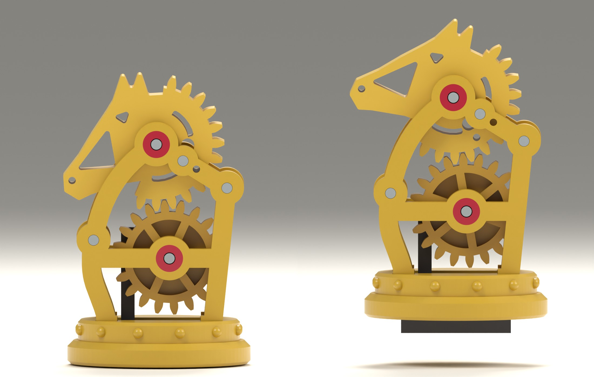

# Knight: design notes

*First build, 2026-11-13. Model `clockwork_knight` 0.1.0, variant `playing`. Modelled and
checked in CAD only: nothing has been printed, so every fit below is a starting value.*

## 1. What was built

The knight of `brief.md`, section 4: the head rears when the piece is lifted and bows when it
is set down. The mane is a real gear in the load path, not decoration.

It was built first because the client picked it as the set's signature piece. The brief's
advice to prototype the pawn first (tightest fit, sixteen of them) still stands for the set.

Films: [`img/knight/motion.gif`](img/knight/motion.gif) (one lift and setting down) and
[`img/knight/mechanism.gif`](img/knight/mechanism.gif) (the same with the left plate taken
off). Other stills are in `img/knight/`.

## 2. Decisions this build assumes

The three decisions in `brief.md` section 6 were not answered before this build. It follows
the brief's recommendations. **The client has not confirmed them.**

| Decision | Assumed | Effect if it changes |
|---|---|---|
| Hardware | Steel allowed: five pins Ø2 × 16 and one pin Ø6 × 18 per knight | Without the Ø6 weight the plunger weighs 1.5 g against the head's 1.0 g (section 6), which is too little margin. Printed arbors would need new bores and thicker hubs |
| Size | Playing size: base Ø35 mm, 55.6 mm tall | At 1.5× everything gets easier; the parameters scale, the pin sizes do not |
| Files or printed sets | Not decided. Fits are generous and all are parameters | Selling files means the snap feet and pin fits must survive other printers; test prints decide |

One departure from the brief: the weight is a steel pin lying in the plunger, not a ball. A
Ø6 × 18 pin is 4.0 g in a bar 8 mm high; a ball of that weight would be Ø10 and would not
fit under the wheel.

## 3. How it works

Side view: X to the right, Z up, seen from the horse's left; the horse faces -X.

1. **Plunger.** A bar in a slot through the base, with the steel weight inside it. Standing,
   its foot is flush with the base. When the piece is lifted the plunger stays on the board
   for the first 3.0 mm, then hangs from two ears on a ledge in the slot.
2. **Rack and pinion.** A three-tooth rack on the plunger turns a 10-tooth pinion (profile
   shift +0.4). 3.0 mm of travel is 34.4° of the pinion.
3. **Chest wheel.** A 20-tooth wheel, one part with the pinion.
4. **Mane.** A slice of a 24-tooth gear, thirteen teeth, one part with the head. The head
   turns 28.65° (34.4° × 20 / 24). The nose rises about 10 mm.
5. **Stops.** Down: the ears on the ledge. Up: the board. A steel banking pin in a slot in
   the mane stops the head 3° past either end, so a finger on the plunger or on the nose
   cannot drive the train further.

All gears are module 1.0 with 0.12 mm backlash, as on Fala.

## 4. Parts

Every printed part is a flat plate with a pierced outline and prints lying down without
support, except the base.

| Part | Size (mm) | Prints | Notes |
|---|---|---|---|
| `base` | Ø35 × 8.5 | upright | Slot for the plunger, four mortises, twelve studs |
| `plate_left`, `plate_right` | 32 × 46 × 3 | outer face down | Posts and bearing rings on the inner face; sprung feet |
| `jewel_*` (4) | Ø5.2 × 0.8 | with the plate, first layers | Red rings flush in the outer faces; the arbors turn in them |
| `wheel` | Ø22 × 9 | spoked face down | Wheel 4 mm, pinion 5 mm; spokes stand on a 0.8 mm web |
| `head` | 31 × 26 × 9 | either face down | Head and mane; arc slot for the banking pin |
| `plunger` | 23 × 26 × 9 | rack side down | Foot bar, ears, tunnel for the weight, rack |

Steel (named `reference_*` in the model, left out of the printable files):

| Item | Size | Count | Fit |
|---|---|---|---|
| Arbor | Ø2 × 16 | 2 | Pressed into head and wheel (bore 2.1), turns in the plates (bore 2.3) |
| Pillar | Ø2 × 16 | 2 | Pressed through both plates, inside the posts |
| Banking pin | Ø2 × 16 | 1 | Pressed through both plates |
| Weight | Ø6 × 18 | 1 | Slides into the plunger from the rear end; the slot's end wall keeps it in |

Sizes are ISO 2338 nominal sizes; verify against the supplier's sheet.

## 5. Across the piece

16.0 mm in all, the length of the pins. Plates 3.0 each, 10.0 between them. Moving parts are
9.0 thick and bear on rings 0.3 high around the bores, which leaves 0.2 play each side.
The wheel is on the left (the side the concept picture shows), the pinion and rack behind it.

## 6. Figures

All from the model; `knight.balance()` and the tests reproduce them.

- **Size.** Base Ø35. Standing 55.6 mm tall, nose 0.8 mm past the base. Lifted 59.8 mm tall,
  nose 2.8 mm past the base.
- **Weight.** 23.7 g with steel, at PLA density. Plunger with its weight 5.5 g.
- **Balance of the head.** 4.7 g, centre of mass 1.3 mm in front of the arbor. Through the
  train that is 1.0 g holding the plunger up. The plunger is 5.5 times heavier.
- **Gear clearance.** 0.11 mm between flanks at every position checked.
- **Lost motion.** The pinion has 1.4° of play either way over the whole travel, which is
  the backlash and nothing more.

Friction is not modelled. The margin of 5.5 is against the head's weight only.

## 7. How it goes together

The order matters, because a rack cannot be pushed past a pinion that is not free to turn.

1. Push the weight into the plunger. Drop the plunger into the slot in the base.
2. Press the two pillar pins into one plate. Push both plates into the base until the feet
   click, and press the plates together over the pillars.
3. Press an arbor into the wheel. Slide the wheel in from behind, between the plates and
   under the rear post, until the pinion sits in the rack. The wheel may be turned to any
   tooth: it looks the same every 36°. Push the arbor home through the plates.
4. With the piece standing on the table, lower the head in from above with the nose down.
   Turn it until the **timing hole** (Ø1.4, in both plates and in the mane) shows through.
   One tooth out moves the hole 2.3 mm, so it cannot be mistaken. Push the arbor through.
5. Press the banking pin through the plates and the slot.

For steps 3 and 4 the arbor has to be pressed through the part while it sits in the frame.
Flat pliers across the two plates do it and stop when the pin is flush.

## 8. What the tests show

`tests/test_knight_motion.py`, 12 tests, and the snapshot in `tests/test_knight.py`:

- The head turns 28.65° over the travel and nothing turns further above it.
- No part overlaps another standing, at four positions through the travel, or held up.
- Gear clearance stays between 0.05 and 0.2 mm; 2.5° either way always meets a tooth.
- The ears sit on the ledge when hanging; the banking pin is clear over the swing and stops
  the head within 3.3° beyond it.
- The plunger is more than four times the head's pull.
- The timing hole is open through both plates and the head at rest, and nowhere else.
- The wheel goes in from behind and the head from above along clear paths.
- Four impossible sets of parameters are refused.

## 9. Tried and dropped

- **A rack whose top tooth enters first**, so that the frame could be lowered onto the rack
  with the head already in. It gave one unambiguous assembly, but the rack then holds the
  pinion in one direction only near the hanging end: 7° to 11° of free droop of the head.
  Replaced by a rack that is fully engaged at both ends, and the timing hole.
- **The mane as a solid disc.** It read as a shield behind the head. Now a rim with two
  windows; the web between them carries the banking slot.
- **The head at the concept picture's size.** Too nose-heavy: 2.9 g at the plunger. Scaled
  to 93%, moved 1.5 mm back on its arbor, cheek window enlarged, mane rim thickened.
- **Toes on the plates over the plunger's ears**, as an upward stop. They were in the
  wheel's way during assembly, and the banking pin already does the job.

## 10. Open points

1. **Nothing is printed.** Pin fits (`pin_run` 0.3, `pin_grip` 0.1), the sprung feet
   (`prong`, `barb`, `catch`), the slot clearance (`slide` 0.3) and the weight's tunnel are
   guesses until a test print.
2. **Surfaces are plain.** No chamfers on the plates or the head, no relief. The outlines
   are the first ones that balanced and cleared; the look deserves its own pass. Seen
   nose-on the piece is a stack of flat plates 16 mm wide on a 35 mm base
   (`img/knight/front.jpg`): the side is its good view.
3. **The wheel's spokes are not see-through.** The pinion has to print on something, so the
   spokes stand on a web. From the left the rack and pinion are hidden behind it.
4. **The feet cannot be released** once clicked in. Fine for a sold piece, awkward for a
   prototype: print the first one with `barb` near its lower limit.
5. **The head is nose-heavy by 1 g at the plunger.** It works on paper with a margin of
   5.5. If friction turns out high, the next step is a steel pin in the mane.
6. **A knocked-over piece.** The plates are printed flat and are strong in their plane. The
   ears of the head are the thinnest feature and take the fall; not checked.
7. **Rattle.** The weight has 0.2 mm of play in its tunnel and may be heard.
8. **Shared parts.** Base, plunger and the drawing helpers are in the knight's files and in
   `_shared.py`. When the second piece is built they should be generalised, and the helpers
   moved to `cadkit`.

## 11. Ideas for the test prints

- One knight complete, in one colour, before any multi-colour print.
- A fit ladder for the Ø2 pin: bores 2.0 to 2.4 in steps of 0.05, in a 3 mm and a 9 mm strip.
- One foot with its mortise, at three values of `barb`.
- The plunger in its slot alone, with the weight: does it drop freely, does it rattle.
