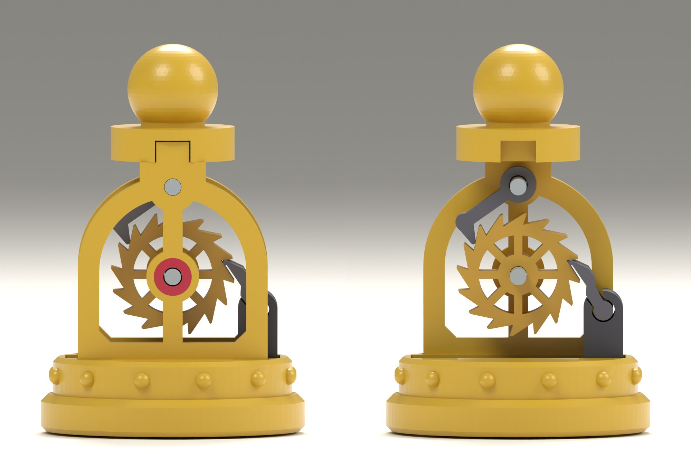

# Pawn: design notes

*First build, 2026-11-14 (seventh session). Model `clockwork_pawn` 0.1.0, variant `playing`.
Modelled and checked in CAD only: nothing has been printed, so every fit is a starting value.*

**The pawn works in the model: every move turns its wheel on by one tooth, and the wheel
cannot turn back. Its weak point is known and measured: the pawl falls back towards the wheel
by its own weight only, and that weight is a tenth of a gram (section 10, point 2).**

## 1. What was built

The pawn of `brief.md`, section 4: a ratchet and its click. The wheel turns one way only, as a
pawn only goes forward, and it goes on by exactly one tooth with every move.

When the pawn is lifted, a weighted plunger stays on the board for the first 4.5 mm. The pawl
that stands on it rides down over the next tooth of the wheel and falls under it. Set down,
the board pushes the plunger home, the pawl pushes its tooth up, and the click on top of the
wheel is lifted over one tooth and falls behind it. The wheel can also be turned on with a
finger, click by click; it does not turn back.

The client asked for it on 2026-11-14 ("Continue building the chess set with the pawn"). The
brief advised the pawn first of all: it is the tightest fit and there are sixteen of them.

Films: [`img/motion.gif`](img/motion.gif) (two moves: lifted and set down twice) and
[`img/mechanism.gif`](img/mechanism.gif) (the same with the near plate taken off). After two
moves the wheel, with sixteen teeth and eight spokes, looks as it did, so the film loops.
Other stills are in `img/`.

## 2. Decisions taken in this build

These were mine, taken while modelling. The client has not seen them yet.

| Decision | Taken | Why | If it changes |
|---|---|---|---|
| Base | Ø32 mm; the brief estimated 30 | The plates' four feet have to stand inside the base's drum, outside the wheel. On a Ø30 base the columns would stand in front of the wheel's teeth. 32 is also the usual pawn beside a 44 mm king | Everything scales with it; the wheel would have to shrink |
| Travel of the plunger | 4.5 mm; the knight has 3.0, the king 4.0 | One tooth is 2.6 mm at the pawl's nose, the wheel falls back 0.5 mm, and the pawl needs 0.9 mm more to get round the tooth's tip. 4.5 leaves 0.5 mm to spare | A wheel with 18 teeth would do with 4.2 mm and finer teeth |
| Wheel | Ø15, sixteen teeth | A Ø16 wheel filled the window better, but the pawl then leaned less and fell in less surely (section 9) | |
| Frame | A round-headed window, as the pawn in the concept picture; the king's is pointed | The arch runs round the wheel and carries the click's pin at its top | |
| Head | A separate part: round collar and ball | Two flat plates have no ball. The head also holds the plates together at the top | |
| Colours | Click and pawl dark, like the plunger | Both are small; in the frame's colour the click could not be told from the arch behind it | Any filament does: they are separate parts |

The three decisions of `brief.md`, section 6, stand as the client answered them: steel is
allowed, playing size, files or printed sets not decided.

One point of the brief is **not met**: it asked for a pawn that prints nearly in one piece.
This pawn has eight printed parts and three pieces of steel. The knight has six and six, the
king ten and eight. What was done to keep the count down: the two plates are the same part,
there are no pillars (the click's pin and the head hold the plates), and the pawl turns in a
printed socket without a pin. A pawn in one piece would have to print its wheel in place
between two plates, which a flat-printed plate cannot do.

## 3. How it works

Side view: X to the right, Z up, seen from the front (-Y), arbors along Y. The wheel turns
counter-clockwise. Its arbor stands 19.0 mm above the board, the click's pin 29.9 mm.

1. **Wheel.** Sixteen saw teeth, Ø15 over the tips. Each tooth has a steep face, undercut by
   10°, and a long sloping back. Eight spokes.
2. **Plunger.** A bar in a slot through the base with a steel weight in it, as on the knight
   and the king. Standing, its foot is flush with the base. Lifted, it stays on the board for
   4.5 mm and then hangs from two ears on a ledge in the slot.
3. **Pawl.** A short lever, 7.0 mm from its knuckle to its nose. The round knuckle lies in a
   socket on the plunger's right end; the pawl stands on it and leans 34° towards the wheel.
   Its nose lies in the corner under a tooth's face, at the level of the wheel's arbor.
4. **Click.** A lever that hangs from a steel pin at the top of the arch. Its beak lies on
   the wheel at ten o'clock.
5. **Lifted.** The pawl goes down with the plunger. For the first 0.56 mm the wheel follows
   it back, until a tooth's face meets the click: the wheel stands. The pawl's nose then
   slides down the back of the next tooth, which pushes the pawl out by 12°. After 4.0 mm
   the nose passes that tooth's tip and the pawl falls under it. The plunger stops at 4.5 mm.
6. **Set down.** The pawl comes up 1.46 mm free, meets the face of the tooth above it, and
   pushes it up over the last 3.04 mm. The wheel turns 26.9°: one tooth and the fall-back.
   Meanwhile the back of a tooth lifts the click by 6.9°; shortly before the end the click
   falls behind that tooth.
7. **Stops.** The plunger hangs on its ears. The lips of the socket stop the pawl 15° out
   and 6° in from where it stands at rest. The head stops the click before it can swing over
   the top.

Why the wheel cannot turn back: a face that pushes on the click pushes almost along the line
to the click's pin, and by 7.9° to the side that draws the beak deeper into the corner. For
the pawl that angle is 29.6°.

## 4. Parts

Every printed part but the base and the head is a flat plate with a pierced outline and
prints lying down without support.

| Part | Size (mm) | Prints | Notes |
|---|---|---|---|
| `base` | Ø32 × 9.0 | upright | Slot for the plunger, four mortises, twelve studs |
| `plate_left`, `plate_right` | 24 × 35 × 2.5 | outer face down | **One part, printed twice**: the outline is the same left and right. Sill, two columns, round arch, a mullion with the two bosses; a boss 2.3 high and a half post 2.8 high on the inner face; sprung feet |
| `jewel_*` (2) | Ø4.6 × 0.8 | with the plate, first layers | Red rings flush in the outer faces; the wheel's arbor turns in them |
| `wheel` | Ø15 × 4.0 | either face down | Sixteen teeth, eight spokes |
| `click` | 10 × 9 × 3.0 | either face down | Eye, arm, beak |
| `plunger` | 25 × 17 × 7.0 | either face down | Bar, ears, tunnel for the weight, stem with the socket |
| `pawl` | 5 × 7 × 7.0 | either face down | Knuckle, neck, bar, nose; as thick as the plunger |
| `head` | Ø15 × 14 | upright | Round collar with a notch for the tenon on each plate's top; ball Ø11 on a neck |

Steel (named `reference_*` in the model, left out of the printable files):

| Item | Size | Count | Fit |
|---|---|---|---|
| Arbor of the wheel | Ø2 × 14 | 1 | Pressed into the wheel (bore 2.1), turns in the plates (bore 2.3) |
| Pin of the click | Ø2 × 14 | 1 | Pressed through both plates (bore 2.1); the click turns on it (bore 2.3) |
| Weight | Ø5 × 22 | 1 | Slides into the plunger from the right end; the slot's end wall keeps it in |

Sizes are ISO 2338 nominal sizes; verify against the supplier's sheet. A set of sixteen pawns
takes 128 printed parts, 32 pins of Ø2 × 14 and 16 of Ø5 × 22.

## 5. Across the piece

14.0 mm in all, the length of the pins. Plates 2.5 each, 9.0 between them. The wheel is 4.0
thick and stands in the middle, on a boss from each plate, with 0.2 play each side. The click
is 3.0 thick and lies between two half posts round its pin. Plunger and pawl are 7.0 wide and
pass 1.0 from each plate. Everything is the same on both sides, so the pawn has no front.

## 6. Figures

All from the model; `pawn.balance()`, `pawn._layout.move()` and the tests reproduce them.

- **Size.** Base Ø32, 46.9 mm tall. Held up, the plunger hangs 4.5 mm below the base.
- **Weight.** 15.3 g at PLA density: 11.2 g printed, 4.1 g steel. The plunger with its
  weight and the pawl is 4.9 g; it gives 0.22 mJ per lift.
- **Wheel.** 22.5° per move. 2.95 mm from tip to tip, teeth 1.4 high, a flat of 0.3 on each
  tip. A nose of radius 0.3 lies in a tooth's corner 6.54 mm from the arbor; one tooth is
  2.57 mm there.
- **One move.** Fall-back of the wheel 4.4°, which is 0.5 mm at the nose and the first
  0.56 mm of the plunger's way down. Pawl under the next tooth after 4.0 mm, so 0.5 mm of
  travel to spare. On the way up 1.46 mm free, then 3.04 mm of push.
- **Pawl.** 0.10 g. Its centre of mass stands 1.16 mm to the wheel's side of its knuckle at
  rest, and 0.69 mm when a tooth has pushed it out furthest. That, times its weight, is all
  that brings it back.
- **Click.** 0.09 g, 8.8 mm from pin to nose. Its centre of mass hangs 2.6 mm to the wheel's
  side of its pin.

Friction is not modelled. The motion is rigid geometry, followed in steps of 0.02 mm of the
plunger's travel.

## 7. How it goes together

Worked out on the model. Not tried with parts.

1. Push the weight into the plunger from its right end. Slide the pawl's knuckle into the
   socket from the side. Drop the plunger into the slot in the base.
2. Lay one plate down with its inner face up. Press the click's pin into it and put the
   click on the pin. Press the arbor into the wheel and stand it in the plate.
3. Lower the second plate over both pins and press it home. Press the head over the two
   tenons.
4. Hold the base in the air, so that the plunger hangs, and push the frame's four feet into
   it until they click. The wheel may need a nudge if a tooth's tip comes down on the pawl.

Both plates are the same part, so there is no left and right to mix up. The pawl is kept in
its socket sideways by the plates.

## 8. What was checked, and what was not

`tests/pawn/test_motion.py`, 16 tests, and the snapshot in `tests/pawn/test_model.py`:

- A move turns the wheel on by exactly 22.5°; lifted, the wheel falls back 4.4° and stands;
  set down, it only goes forward; pawl and click end where they began.
- The pawl is under the next tooth 0.5 mm before the plunger hangs, and meets its face
  1.46 mm after the plunger starts up.
- Standing and hanging, the noses of pawl and click touch the teeth they should.
- With the click in its tooth, a wheel turned back by 1° or 3° runs into it; standing, a
  wheel turned back runs into the pawl.
- No part overlaps another: standing, at nine heights on the way up and nine on the way down.
- The plunger's ears sit on the ledge. The socket's lips are clear of the pawl as far as a
  tooth pushes it and stop it beyond. At the outer lip the pawl still leans towards the
  wheel. The head stops the click before it can swing over the top, while it still hangs to
  the side it fell from.
- Weights, the height, and that nothing stands out past the base.
- The film shows two moves and ends as it begins.
- Seven impossible pawns are refused.

`cadkit` has the ratchet's geometry (`features/ratchet.py`, 12 tests): the wheel's outline,
where a nose lies in a tooth's corner, where a pawl comes to rest, and how surely a tooth
holds it.

**What this is not.** No friction, no dynamics: whether the pawl and the click really fall,
and how fast, the model does not say. Not checked: a pawn that is lifted less than 4.0 mm, a
pawn that is tilted while it is lifted, the wheel turned by a finger while the pawn stands,
the feet and the head as fits, and step 4 of the assembly.

## 9. Tried and dropped

- **A steel roller as the pawl**: a loose pin in a slanted slot on the plunger, which rolls
  under the next tooth. It needs no bearing and rolls instead of sliding. But a Ø2 pin needs
  teeth 2.2 mm deep, twelve instead of sixteen, and the slot has to rise outwards for the
  pin to roll back in; together that asked for about 5.5 mm of travel, by a calculation on
  paper.
- **A Ø16 wheel.** The pawl's knuckle cannot stand further out than 10.3 mm from the middle,
  because the slot would break out of the base's drum. With the larger wheel the pawl leaned
  30° instead of 34°, and its centre of mass stood 0.50 mm inside the knuckle when pushed
  out, instead of 0.69.
- **A pawl whose top lies under the face as the face stands at rest.** The pawl only rises;
  its tooth turns 26.9° while it is pushed. Early in the push the tooth cut into the pawl's
  top. The top is now cut for where the face stands when the pawl first meets it.
- **A straight pawl through the middle of the gap.** At rest the pawl lies along the back of
  the tooth below, 0.3 mm from it. Its bar therefore stands wholly on the outer side of the
  line from knuckle to nose, and only the round nose reaches into the wheel.
- **A frame like an upside-down Y**, with the wheel free on both sides. Everything would be
  in view, and fingers would hold the pawn by the wheel's teeth.
- **A weight of Ø5 × 20.** It could slide 2.2 mm in its tunnel. Ø5 × 22 slides 1.2 mm.

Found on the way, and now in `cadkit`'s ratchet:

- **A click needs the wheel to go a little too far.** With an undercut face the nose cannot
  swing straight into the corner behind a tooth: after exactly one tooth it still hangs on
  the tip's edge. The wheel has to turn on a little more and then fall back onto the click.
  That is what the fall-back of 0.5 mm is for; the click needs less than a fifth of it.
- **Next to an undercut face the way out is narrow.** Followed in coarse steps, a pawl that
  starts down a tooth's back seemed to jump out over the tooth above. The search for where a
  pawl comes free now starts in steps of 0.004°.

## 10. Open points

1. **Nothing is printed.** The noses are drawn with a radius of 0.3, the flats on the tips
   with 0.3, the knuckle turns in a socket with 0.2 play. All of these print rounder and
   tighter than drawn.
2. **The pawl falls towards the wheel by its own weight only, and weakly.** It weighs 0.10 g
   and its centre of mass stands 0.69 mm inside the knuckle at the moment that counts, when
   it has to fall under the tooth. If the knuckle slides in its socket with a friction of
   0.4, friction alone holds a pawl whose centre of mass is within 0.48 mm. A loose knuckle
   rolls instead of sliding and needs less, about 0.2 mm by my estimate. Either way the
   margin is small, and dust or a thread of plastic weighs as much as the pawl. If the pawl
   hangs, that move does not turn the wheel; the pawn still stands flat and nothing jams.
   The king's pawl has the same weakness (`../king/design-notes.md`, section 12, point 6).
3. **A move that is slid does not count.** The plunger only drops when the pawn is lifted by
   4.0 mm or more. The same holds for the knight and the king.
4. **Felt.** With felt under the base and none under the plunger, the plunger is pushed home
   less by the felt's thickness. The click falls behind its tooth when the plunger is still
   0.47 mm from home, so felt up to about 0.4 mm does no harm; thicker felt has to go under
   the plunger's foot as well.
5. **The teeth are finer than the brief allows.** It names module 1 as the smallest
   dependable tooth, 3.14 mm from tooth to tooth. These are 2.95 mm apart and 1.4 high.
6. **Travel of 4.5 mm.** The pawn drops further onto the board than the knight and the king,
   and its plunger shows more when it is lifted.
7. **Fingers reach the wheel** through the window. It only turns forward, so nothing breaks.
8. **Surfaces are plain**, as on the knight and the king. Seen along the plates the pawn is
   two flat plates 14 mm apart with a disc and a ball on top.
9. **The socket shows beside the right column**: 1.2 mm of the plunger's stem stands out
   past it.
10. **The feet cannot be released** once clicked in, as on the other pieces.
11. **The weight can slide 1.2 mm** in its tunnel and may be heard.
12. **No test of the pawn knocked over.** The columns are 2.6 × 2.5 mm.

## 11. Next steps, in order

1. **The client's view** of the pawn, and of the decisions in section 2.
2. **Test prints.** The pawn is the smallest piece and the cheapest to try:
   - wheel, click and pawl on pins in a flat strip, the pawl's socket on a slide: do both
     fall in, at which tilt do they stop, do the teeth print;
   - the plunger in its slot with the weight;
   - then one pawn complete in one colour.
3. **If the pawl hangs** (point 2): a steel pin of Ø2 × 8 that lies behind the pawl on a
   ramp of the plunger's stem and leans on it. Worked out on paper only: it would push the
   pawl in about six times as hard as its own weight does, harder the further the pawl is
   pushed out, and it rolls. It costs one more pin per pawn.
4. **The next piece.** Rook, bishop and queen are left (`brief.md`, section 4).
