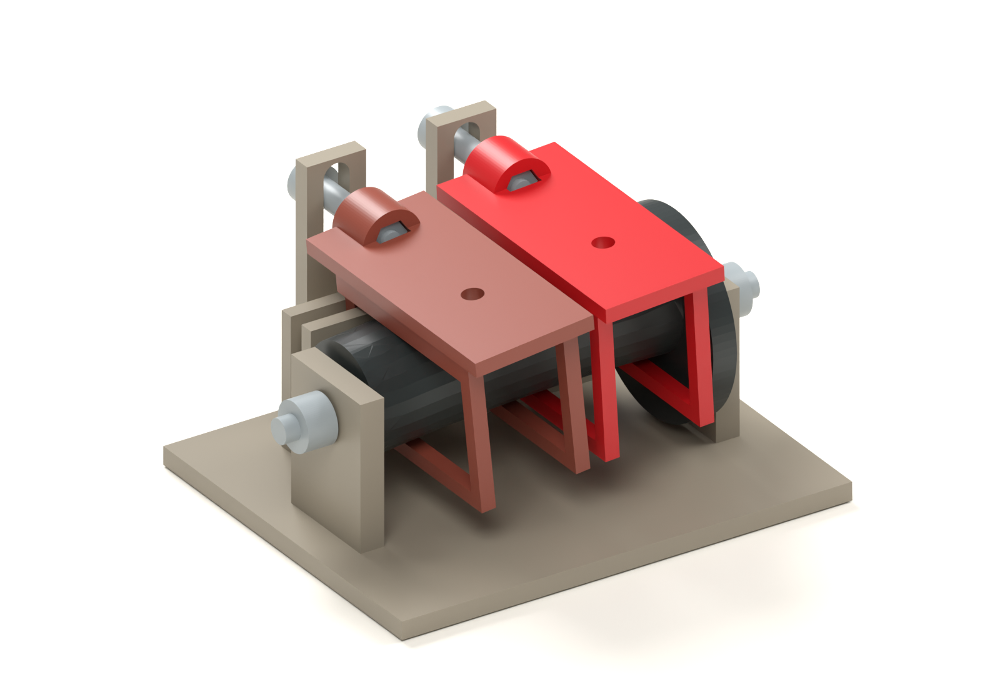
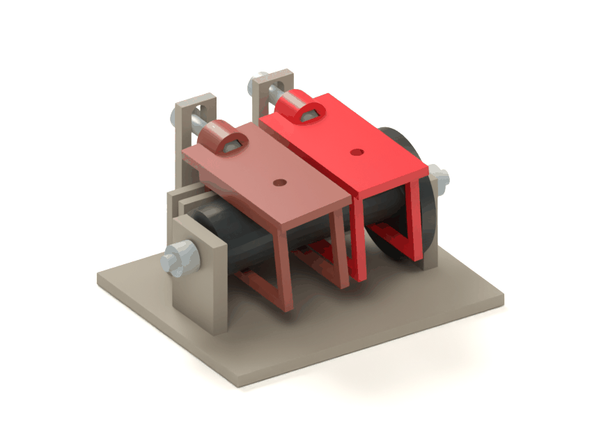
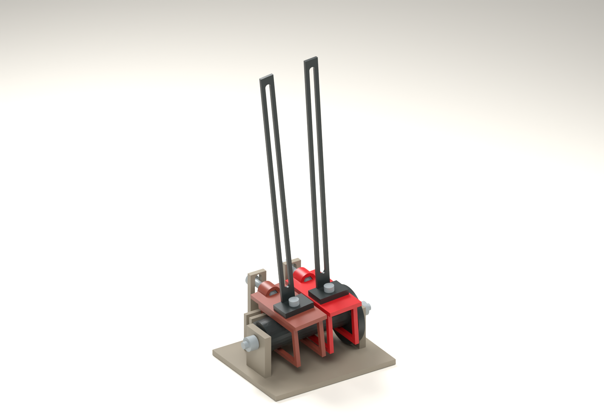

# Fala / Nikisz — finite follower contact and stage 3B test rig

Development rig, model `fala` **0.2.0**, variant `contact_rig`. The stage 3A contact
solution is retained. Stage 3B adds axis retention, fit coupons, oriented test
exports and a removable loaded-test fixture. Production plates and the decorated
product follow physical tests. See the [U1 test guide](u1-test-guide.md) for
the BOM, print orientation, assembly sequence and measurement protocol.





## What changed

The original narrow follower sampled the cam in the axle's depth plane. That
loses contact as the eccentric section moves sideways: the section's captured
height varies by about **1.42 mm**. Each new C-jaw is **32 mm deep**, so its upper
contact can travel across the full **7 mm** lateral excursion. The spine sits
outside the cam's depth envelope. There is no spring or flexible PLA strip.

Each rigid carriage has two coplanar upper pads, **16 mm apart**, each **2.4 mm**
wide along the shaft. Their world contact positions are solved over the actual
finite faces. Contact can slide along X as well as Y. No moving linkage tries to
hold two prescribed sine samples at a fixed distance: that was the approximately
0.12 mm incompatibility in the earlier screening.

The fixed-X point is a transverse 4 mm smooth shoulder at deck level, running in a
vertical slot. A rear keel between cheeks controls depth, roll and yaw. The
model centres the pin and keel within their running clearances; it does not
pretend that those clearances disappear in a real print.

## Geometry and contact equation

The cam is defined by circular sections normal to X, with radius `R=9` and centres
`y=e cos(kx−φ)`, `z=e sin(kx−φ)`, where `e=3.5`, `k=2π/(176/0.85)` and φ is shaft
phase. It is **not** a round tube swept normal to a helical path. The CAD uses a
smooth loft through 55 circles over a 54 mm active length, with a 4.4 mm axle bore.
The contact study measures separation against that actual loft as well as solving
the analytic surface.

Let the carriage's fixed X position be `x0`, its deck height above the axle be
`h`, its lean be `θ`, and the pad underside be `d=5` below the deck. A candidate
point on a pad, at local coordinate `u`, has:

```
x = x0 + u cosθ + d sinθ
h_required(u, θ) = e sin(kx − φ) + R − u sinθ + d cosθ
```

For each pad, the solver takes the maximum over its finite interval. It includes
both edges and all stationary points; this is not point sampling. It then solves
for the angle at which the left and right maxima agree. The corresponding
height seats both pads on the cam under gravity. Lower faces are tested with the
same method against the bottom of the cam, **18.4 mm** below the upper faces.

The maximum lean is approximately **6.00°**. The seated return clearances are
approximately **0.33–0.50 mm**, including lean and finite face width. These are
clearances in the seated position, **not total free-rocking backlash**. Lift and
rock at roof level still need measurement before this can meet the premium feel
requirement.

## Evidence and its limits

[The machine-readable report](contact-proof.json) records the exact parameters,
source hashes, part metrics, 1,440 analytic phases per carriage, and the BRep
collision/contact sweep. The normal proof command checks 360 positive and 360
negative phases, at **1° intervals**, including both guide pins and the fixed
steel axle. Intersection threshold: `0.00001 mm³`. Sampling does not certify the
continuous swept volume between poses. Opposite phase order demonstrates
geometric reversibility; it does not establish loaded reverse operation.

The separate equal-mass calculation assumes eight 15 g moving units, with each
centre of gravity 30 mm above its deck. It estimates gravity torque only. It
does not establish two-finger effort: friction, guide reactions, filament finish,
gear losses and inertia remain unmeasured. The animation uses the same rigid
poses as the CAD; it contains no independently animated or deforming geometry.

The retained rig has eleven components; the loaded rig has seventeen, including
nominal bought-hardware envelopes. All variants pass the shared BRep,
single-solid, watertight mesh and U1 envelope gate. Snapshots live in
`tests/snapshots/`. The loaded study includes masts/mounting hardware, without
an assumed ballast pack; the real pack must also be checked through full turns.



The [load-fixture clearance report](loaded-proof.json) checks these actual
solids. The [U1 guide](u1-test-guide.md) explains how to set the measured load.

## Rig contents and assembly intent

| Component | Quantity | Purpose |
|---|---:|---|
| Printed frame | 1 | Floor, axle supports, keel cheeks and pin slots |
| Printed cam with thumbwheel | 1 | Direct 1:1 input for observing contact |
| Printed carriage | 2 identical | Two upper pads, captured return faces, deck and keel |
| Steel axle, 4 × 80 mm | 1 | Straight main axis, retained by collars |
| Shoulder screw, Ø4 × 12 / M3 | 2 | Smooth guide in each slot, headed capture and a carriage locknut |
| M3 locknut, at most 4 mm tall | 2 | Guide retention, front-loaded nut pocket |
| Shaft collar, Ø4 / Ø8 × 5 | 2 | Reversible axle retention, 0.5 mm outside each end support |

The retained bare rig has an **80 × 66 mm** footprint, including hardware.
The 1:1 thumbwheel is for this rig. The full product's provisional **3:1** ratio
has not been changed or implemented.

Assembly intent is to thread the two carriages over the cam's **left axial end**,
the right-hand carriage first, before putting the group into the frame. Lower
the group into the keel cheeks, then insert the fixed axle through the end
supports and cam bore. Fit collars and insert shoulder screws through the rear
slots into the carriage locknuts. The rear keels obstruct a simple rearward cam
insertion; the original rear-drop assembly idea does not apply to this rig.
The screw shoulder seats inside the carriage boss, leaving the head clear of
the slot bracket. Retention now has a concrete assembly design; real nut
engagement, tightening, loosening and print fit remain physical checks.

The exported STEP, GLB and 3MF retain assembly coordinates. Individual STL files
in `parts/` also retain those coordinates. `prepare_u1.py` additionally writes
explicitly oriented test geometry in `print/`, with its own manifest and
individual STEP files. These 3MFs are **not configured Snapmaker Orca projects**.
Bridging, support painting, seams, support removal, print time and real fit still
require slicer inspection and a physical print.

## Next stage and acceptance gates

1. **Inspect and print the test package.** Retention and orientation candidates
   are modelled. Inspect permitted hidden end-face support locations and use
   the labelled jaw/axle/keel fit ladder to check 0.3/0.4/0.5 mm nominal
   allowances on the actual U1. Do not
   compensate for a tight fit by sanding contact faces.
2. **Measure loaded motion.** Add a representative mass at the Nikisz centre of
   gravity. Record starting/running force through a complete turn in both
   directions, roof-height lift/rock, noise and any contact marking. The result
   decides whether broad sliding pads are suitable or need a different contact.
3. **Check durability and temperature.** Run the 10,000-turn test and repeat the
   fits after the warm-window trial. No warm-window, overload, shipping or
   endurance claim follows from the present CAD result.
4. **Extend to eight Nikisz bays.** Develop concealed wall/pavement overlaps and
   separate roof envelopes from their swept geometry; then the 3:1 input and
   overload strategy. Verify the whole street before adding facade detail.
5. **Release the decorated product.** A sample facade confirms the four-colour
   look before full plates, production BOM, timed assembly and marketing assets.

## Reproduce

From the repository root:

```
uv sync --all-packages
uv run pytest
uv run cadkit show fala -v contact_rig
uv run python projects/fala/engineering/prove_contact.py --export --render
uv run python projects/fala/engineering/prove_contact.py --variant loaded_rig
uv run python projects/fala/engineering/prepare_u1.py --render
```

Evidence and review images stay in `projects/fala/docs/`; CAD exports and the
Blender scene go to `projects/fala/dist/fala/0.2.0/` (gitignored).
The shared `cadkit` implementation owns contact math, validation, export and
rendering; the product package owns only its dimensions, geometry and poses.
