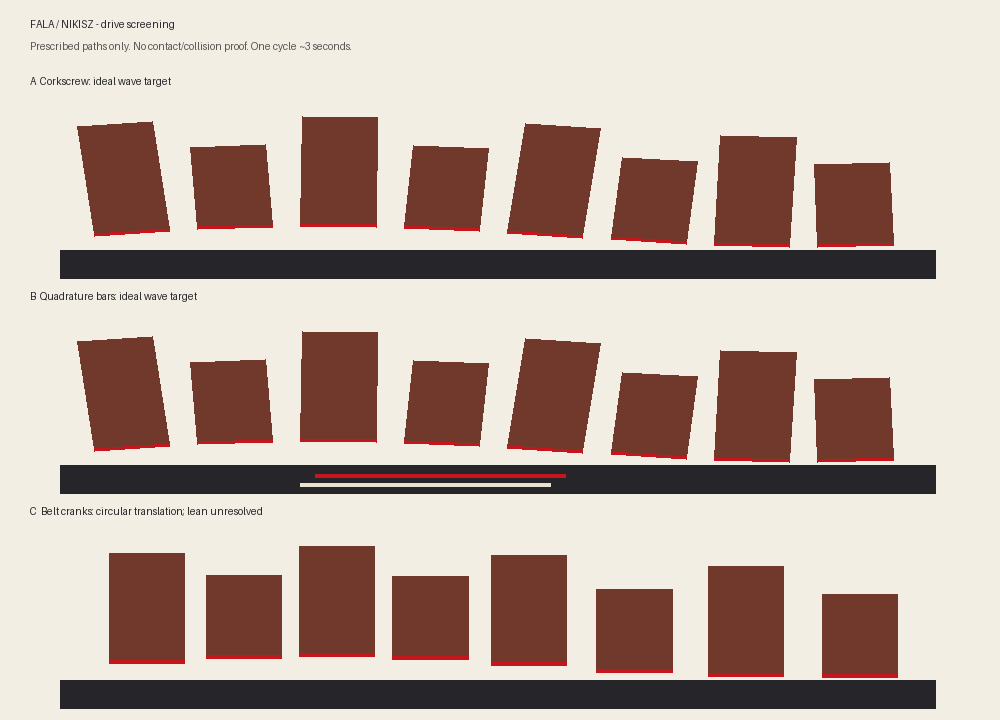

# Fala / Nikisz: drive selection checkpoint

Follow-up: [stage 3A contact rig and actual CAD motion](contact-rig.md) now develops
the approved direction. The screening assumptions and limitations below remain
the record of the drive-selection decision.

Stage: engineering concept screening, 2026-11-13. Client selected the Nikisz visual direction
and requested comparison of drives before choosing. Following this comparison, the client
approved drive A (corkscrew shaft) for development on 2026-11-13. The earlier
Kolonia recommendation is superseded by Nikisz. Dark brick, red windows and the gateway/oriel
remain the visual starting point; final dimensions and palette swatches await prototype work.

The animation shows bare massing blocks, alternating Nikisz heights. A and B show the desired
wave, not the output of solved mechanisms. C shows crank translation without invented lean.
The dimensions behind this study are 8 units, 22 mm pitch, 3.5 mm wave amplitude and 0.85 waves
along the street. They are inherited screening values, not frozen production dimensions.

## Comparison

| Criterion | A: corkscrew shaft | B: quadrature wedge bars | C: belt-driven cranks |
|---|---|---|---|
| Motion source | Rotating eccentric circular sections along one shaft | Two sliding bars driven 90° apart | Eight phase-offset cranks linked by a belt |
| Rise and lean | Two contact stations could set both; contact geometry unresolved | Two independently weighted supports could set both; ramp geometry unresolved | Crank supplies circular translation; lean needs an additional linkage |
| Main benefit | Compact, few drive components, no belt timing | Separates desired motion into two simple harmonic inputs | Familiar rotating joints; avoids a long sliding cam surface |
| Main objection | Captured feet and guide may bind or rattle; see calculation below | Sliding friction and lateral guide loads; long bars and added links | Seven mm sideways travel worsens terrace gaps; phase setting and many joints |
| Nikisz risk | Taller roofs amplify any follower play | Tall bays amplify guide play | Sideways travel plus tall bays makes overlapping joints harder |
| Service | Rear removal of shaft and units could be simple | More internal interfaces to access | Belt and individual crank retention need access |
| First experiment | One shaft section, two captured followers, guide | One quadrature input and one two-point carriage | Two adjacent cranks and one controlled-lean linkage |

The previous 16/24/29 printed-part counts and 17–21 hour estimates are concept allowances.
They omit unresolved retention/contact details. They are not production BOMs or slicer results.
All three still require anti-lift retention, an overload strategy and a concealed, serviceable
transmission. No wear, noise, assembly-time or warm-window claim has been established.

## What the calculations change

**The original corkscrew recommendation was too confident.** At a section of its proposed
9 mm radius bar, the centre moves ±3.5 mm in depth as well as vertically. A broad flat pad
can follow the global top of that section, but its contact point moves 7 mm across the pad.
A narrow pad constrained to the axle's depth plane instead sees a chord whose full height
varies from about 16.58 to 18 mm. An 18 mm capture opening then has about 1.42 mm of potential
play. This is not an inevitable defect in every corkscrew design: it establishes that pad
width, contact position and retention must be designed together. Axial slope of the helix
and carriage rotation add further contact constraints, excluded from this section calculation.

**Two edge heights are not yet a rigid linkage.** Fixing two sample stations 22 mm apart in X
while changing their height difference changes the distance between them by about 0.12 mm.
A rigid carriage cannot meet both exactly. One support needs sliding or rolling freedom, or
the contact coordinates must be solved as part of the linkage. Merely posing a CAD assembly
as a sine chord would conceal this issue.

**Wedge bars need substantial travel.** A 30° ramp needs about 12.12 mm stroke to produce
7 mm lift. Two quadrature inputs can synthesise a sine via
`sin(kx − t) = sin(kx) cos(t) − cos(kx) sin(t)`, but each support needs the correct signed
weights. Two generic ramps and a balance beam do not automatically implement those weights.
Low ramp angles reduce vertical sensitivity but increase stroke and sliding distance.

**A crank is not a rocking carriage.** A 3.5 mm crank radius gives 7 mm travel in both X and Z.
A single crank connection leaves orientation uncontrolled. A parallel guide removes lean;
a designed extra linkage is required to restore it. GT2 also normally introduces a bought
non-PLA belt; that would need an explicit exception to the brief's PLA moving-parts rule.

Equal 15 g moving masses were used only to estimate ideal gravity torque. Friction, mass
variation, gear loss, finger force, stability and overload are not included. The generated
JSON records the assumptions and exact sampled figures; it does not certify smooth effort.

## Recommendation and next stage

Retain **A as the first experiment**, with **B as the fallback**. A still offers the clearest
route to a compact serviceable object, but the next investment should be a small contact rig,
not a decorated full terrace. C is least attractive for Nikisz because sideways travel adds
a second source of opening joints and the mechanism needs extra orientation control.

Before selecting A for the full product, model and compare broad-pad and narrow-pad contact,
including the real helix, captured return faces and guide. Sweep a two-carriage rig in both
directions and measure interference, contact loss and required lateral freedom. Only then
export a fit ladder and endurance rig for the U1. B should receive an equivalent single-carriage
layout if A cannot retain low play without excessive sliding friction.

For Nikisz, do not reuse the concept's broad roof overlaps as collision-free joints. Preserve
the stepped silhouette and gateway, but develop recessed overlapping wall joints and separated
roof envelopes using actual swept geometry. Final product stages remain: solved motion proof,
U1 tests, full decorated design, then production package and marketing scene.

## Reproduction and evidence

Run `uv run python projects/fala/engineering/compare_drives.py` from the repository root.
It regenerates `docs/drive-screening.json` and `docs/img/drive_screening.gif`. The cycle contains
96 distinct frames and loops without duplicating its endpoint. The JSON uses 1,440 phase
samples. Reverse phase retraces these prescribed paths; this is not a loaded reversibility
test. No detailed product geometry, print-ready plate or production validation is claimed.
