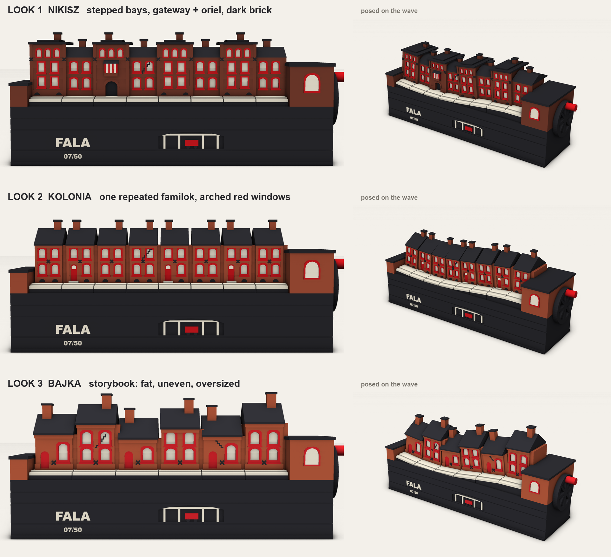
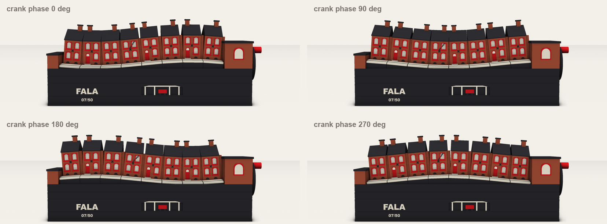
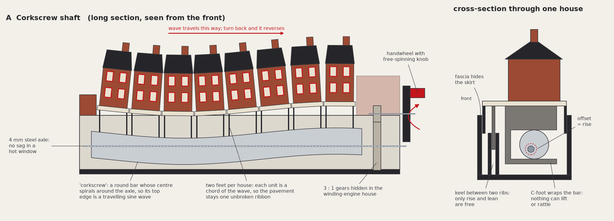
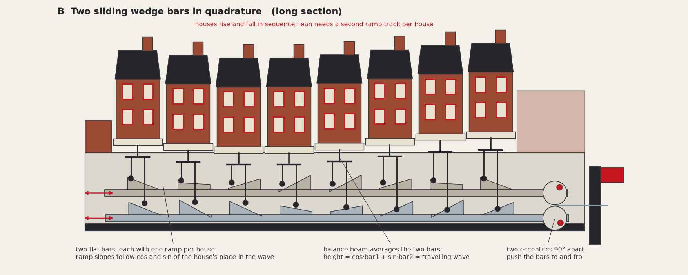
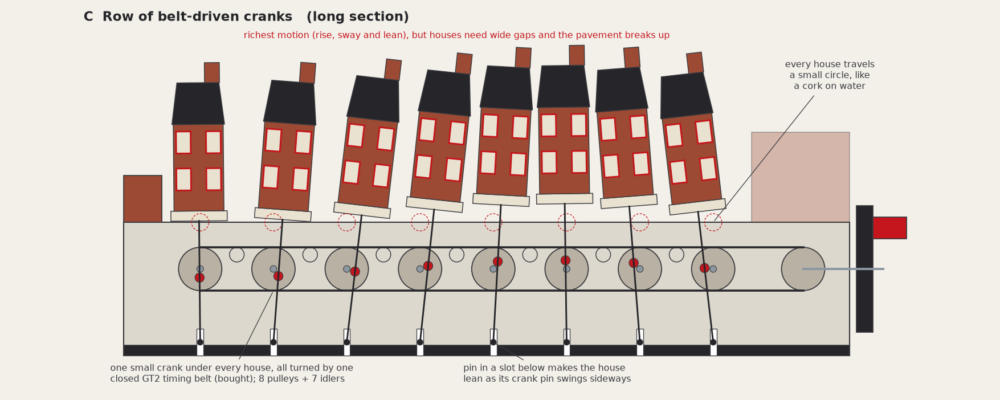

# Fala: look brief and concept checkpoint

**Status (2026-11-13): the motion proof (step 3) is under way on Look 1 "Nikisz" and drive A
"corkscrew". That choice is recorded as approved by the client only on the branch
`projects/fala/codex`; confirm it with the client. The recommendation of Look 2 below is the
concept checkpoint as it was presented. See `../README.md` for the current state.**

How to view: open this file's preview in VS Code (`Shift+Cmd+V`). The three concept looks are also
live in the OCP CAD Viewer panel, where you can orbit them. To regenerate everything:

```
uv run python projects/fala/concept/look_concepts.py --strip   # 3 looks -> OCP viewer + PNGs
uv run python projects/fala/concept/compose_sheets.py          # comparison sheet + filmstrips
uv run python projects/fala/concept/mechanism_diagrams.py      # mechanism diagrams + wave numbers
```

## 1. Recommendation in short

- **Look: 2 "Kolonia"**, one repeated colony familok with arched red windows, with the gateway
  house from Look 1 as an optional accent.
- **Drive: A "Corkscrew shaft"**, one rotating part under the street, every house standing on it
  with two feet.
- **Motion:** one slow swell on the street at any time, 7 mm of rise and fall, houses leaning
  up to 6° each way, three crank turns per full wave.
- **Palette:** four filaments for the whole piece: brick, signal red, bone white, coal black.
- **Size:** about 222 × 62 × 98 mm including the handwheel and the top of the wave.



## 2. What the research says

### 2.1 Real familoks

I studied photos of Nikiszowiec and Giszowiec (Katowice), Ficinus, Kaufhaus and Godula (Ruda
Śląska), Kolonia Zgorzelec (Bytom) and Chwałowice (Rybnik).

| Feature | Seen in the photos | Decision at this scale |
|---|---|---|
| Brick mass | Red to dark brown-red brick, long two or three storey blocks, one bay repeated many times | **Essential.** One brick colour; print layer lines stand in for brick courses |
| Window | Segmental brick arch, white pane or lace curtain, red painted frame or reveal, red sill | **Essential, and the single strongest sign.** Arch + red surround + red sill + bone pane |
| Rhythm | Identical windows in strict rows, string course between floors, cornice | **Essential.** Two windows per floor, string course and cornice as relief |
| Roof and chimneys | Dark low or medium pitch roofs, a row of brick chimneys | **Essential.** Coal roof, one fat chimney per house |
| Plinth | Darker base course with half-round cellar windows at pavement level | Keep, as small coal half-rounds |
| Doors | Plain doors with a step, or arched gateways (*ajnfart*) into the yard | Keep a red door with a step; gateway as accent |
| Nikiszowiec extras | Oriels over gateways, stepped bays, arcades, rose mosaic | Oriel and gateway optional; mosaic dropped (needs more than 4 colours) |
| Giszowiec | Detached cottages, white render, steep red tile roofs | Dropped: not a terrace, reads as "cottage" |
| Ficinus | Sandstone walls with brick window surrounds | Dropped: without the brick a foreign visitor reads "stone cottage" |
| Brick bond, T-bar mullions, curtains, downpipes | Present everywhere | Dropped, too fine for a 0.4 mm nozzle (mullion to be tested once) |

### 2.2 Real mining damage

| Real sign | Evidence | Use in Fala |
|---|---|---|
| Buildings out of plumb | Reported figures (see section 9): 25 mm/m (1.4°) as the safety threshold; rectified buildings had reached 62 to 118 mm/m (3.6° to 6.7°) | **The main sign.** Houses lean up to 6°, the top of the reported range, so it stays believable |
| Ground that sinks | Bytom: almost 68% of the built-up area subsided; 5.5 m on average, about 35 m at most | The pavement ribbon rises and falls 7 mm. Only the speed is exaggerated |
| Stepped cracks along the mortar joints | Bytom, Siemianowicka 7 (2024) | One small stepped crack on one or two houses, as a shallow coal inlay |
| Steel ties and anchor plates | Engineering papers describe steel ties anchored at the corners | Small coal X plates between the floors: reads at a distance, an insider detail |
| Joints between building segments | Visible as the terrace opens and closes | The gaps the motion needs become designed joints, filled by a recessed brick tongue |
| Raking timber shores, boarded windows, demolition | University of Silesia photos; Bytom-Karb 2011 | **Not used.** They read as danger and loss, and shores are fragile |
| Flooded hollows (*zalewiska*) | Common in the region | Not used: cannot be read on a street |

### 2.3 Wave motion that reads

- Builders of wave pieces use **8 to 12 elements per wavelength**: nine discs stepped 45°
  (Margolin), eight cams at 45°, twelve at 30°. Fala has 8 houses over 0.85 of a wave, which is
  9.4 houses per wavelength.
- **Identical elements** make the phase difference legible. Variety belongs on what rides the
  wave, not on the wave itself.
- **Pure eccentrics give a pure sine**, with no dwell and no jolt, and the phase offset between
  neighbours is what makes it travel.
- Motion feels organic when elements move in **two directions at once** (McSweeney's waves move
  sideways and vertically). In Fala the lean does this: each house tips towards the oncoming
  trough a quarter cycle before it sinks, as a boat does.
- The known failure is **followers leaving their cams** or binding. Followers must be captured.

### 2.4 What looks good printed

- Real multi-colour FDM prints look best as **large flat colour blocks with crisp edges**
  (Snapmaker's own U1 samples, the low-poly Bratislava castle souvenir). Fine multi-colour
  detail looks cheap.
- Flat walls show layer lines. Printed upright, the lines run horizontally and read as **brick
  courses on walls and tile courses on a roof**, so orientation hides them instead of texture.
- Roofs flatter than about 35° show ugly stepping, so the roofs are 37° or flat.
- Working limits for this piece: relief at least 0.8 mm wide and 0.5 mm proud, colour inlays at
  least 1.0 mm wide, free-standing features at least 4.5 mm thick, lettering at least 4 mm high.

### 2.5 The market

- Katowice souvenir shops sell graphic and textile goods, coal jewellery, soot soap, ceramic
  tile magnets and generic city magnets. A cardboard model kit of a Ruda Śląska familok exists.
- I found **no three-dimensional familok figure and no kinetic Silesian souvenir**. Kinetic city
  souvenirs elsewhere are wooden self-assembly kits (Timberkits London).
- Fala differs by being finished, moving, numbered and about a story only Silesia has.

## 3. References

Photos are real photographs, not renders. Each line says what to take from it.

**Familoks**
1. [Familok windows, Ruda Śląska](https://commons.wikimedia.org/wiki/File:Familok_okna.JPG): the canonical window: brick arch, red frame, red sill, string course.
2. [Kaufhaus settlement, Ruda Śląska](https://commons.wikimedia.org/wiki/File:Familoki222.JPG): the terrace rhythm: identical blocks, chimney row, red windows legible from afar.
3. [Kolonia Zgorzelec windows, Bytom](https://commons.wikimedia.org/wiki/File:Bytom_-_Kolonia_Zgorzelec_19_okna.jpg): white frame inside a red painted reveal with red sill: the colour split to print.
4. [Nikiszowiec, Plac Wyzwolenia 12](https://commons.wikimedia.org/wiki/File:Osiedle_Nikiszowiec,_Katowice,001,_2021-3.jpg): arched gateway with oriel above, stepped bays, cellar half-rounds.
5. [Nikiszowiec, ul. Czechowa](https://commons.wikimedia.org/wiki/File:Ulica_Czechowa,_zabytkowe_osiedle_Nikiszowiec,_Katowice,_27_czerwca_2024,_067_KsP.jpg): street proportions; red reveals carry the whole street.
6. [Nikiszowiec rose mosaic](https://commons.wikimedia.org/wiki/File:2024-06_Nikiszowiec_(7).jpg): deep eaves and tiled roof; mosaic noted but dropped.
7. [Chwałowice, Rybnik](https://commons.wikimedia.org/wiki/File:Rybnik,_Chwałowice,_familoki,_ulica_1_Maja_02.jpg): pilasters, plinth and cellar openings as relief.
8. [Godula, Ruda Śląska](https://commons.wikimedia.org/wiki/File:Ruda_Śląska,_Godula,_ulica_Kolbe,_familoki.jpg): gable roofs with chimneys along a street.
9. [Ficinus colony](https://commons.wikimedia.org/wiki/File:Ruda_Śląska_Kubiny_DSC_7600.jpg) and [zabytek.pl record](https://zabytek.pl/en/obiekty/ruda-slaska-kolonia-robotnicza-ficinus): sandstone with brick surrounds, 1860s; shows why brick is essential.
10. [Giszowiec house](https://commons.wikimedia.org/wiki/File:Dom_Giszowiec_ul._Radosna_1_Katowice.jpg): garden-city cottage; a different type, not used.
11. [Krakow Post, "Familok"](https://www.krakowpost.com/?p=228): the red frames and their mine-paint story.
12. [Katowice city notice on Nikiszowiec](https://www.katowice.eu/en/Lists/Komunikaty/DispForm.aspx?ID=11): red window reveals named as what gives the place its character.
13. [University of Łódź article on Silesian brick](https://czasopisma.uni.lodz.pl/philosophica/article/download/3625/3156/11357): segmental arches; miners' windows red, steelworkers' green.

**Mining damage**
14. [Bytom, Siemianowicka 7, 2024](https://commons.wikimedia.org/wiki/File:Bytom_Siemianowicka_7_szkody_2024.jpg): stepped crack and sagging string course: the crack shape to stylise.
15. [University of Silesia, "Bytom, the city that is sinking"](https://us.edu.pl/instytut/inoz/en/2022/05/19/bytom-miasto-ktore-sie-zapada/): scale of subsidence; photos of leaning and shored buildings.
16. [Gromysz, rectification of tilted buildings (2024)](https://www.matec-conferences.org/10.1051/matecconf/202439603002): real tilt figures, which set the 6° lean.
17. [Bytom-Karb demolition, 2011](https://commons.wikimedia.org/wiki/File:Bytom-Karb_-_Demolition_06.jpg): where it ends in reality: the tone to avoid.
18. [Wprost on Bytom's compensation](https://www.wprost.pl/kraj/265214/246-mln-zl-odszkodowania-dla-bytomia-od-kompanii-weglowej.html) and [Rzeczpospolita on money instead of repair](https://www.rp.pl/ubezpieczenia-i-odszkodowania/art9883841-pieniadze-zamiast-przywrocenia-stanu-poprzedniego): the dispute behind the card line.

**Wave motion**
19. [Reuben Margolin, Square Wave](https://www.reubenmargolin.com/waves/square-wave/): nine discs stepped 45° give exactly one wavelength per turn.
20. [Ross McSweeney's hand-cranked wave](https://laughingsquid.com/wooden-hand-cranked-kinetic-wave-sculpture/): identical slats, a character riding them, two-direction motion.
21. [Instructables, "Making Waves"](https://www.instructables.com/MAKING-WAVES-1) and [a 12-cam build](https://class.textile-academy.org/2025/isobel-leonard/development/Sculpture%203%3A%20Process%20Amphitrite/): element count and phase step.
22. [UT Austin student build notes](https://cloud.wikis.utexas.edu/wiki/spaces/RMD/pages/51057184): followers that left their cams: capture them.

**Printed look**
23. [Low-poly Bratislava castle souvenir](https://3dwithus.com/3d-print-design-spotlight-bratislava-castle-by-laila): chunky printed architecture; layer lines on flat walls.
24. [Snapmaker, four multi-colour prints](https://blog.snapmaker.com/blog/inspiring-multicolor-3d-prints/): crisp colour blocks from the U1 at 0.2 mm layers.
25. [Eolas Prints on model finishes](https://eolasprints.com/blogs/architectural-3d-printing/architectural-model-finishing-painted-single-colour-multi-material): colour assigned by material, not by paint.

**Market**: [Katowice visitor shops](https://welcome.katowice.eu/en/visitors), [Astral ceramic magnets](https://www.astral.krakow.pl/downloads/Pamiatki-z-ceramiki-szkla-zywicy.pdf), [familok cardboard kit](https://www.super-hobby.co.uk/products/Familok-Familien-Block-Robotniczy-wielorodzinny-budynek-mieszkalny-z-przelomu-XIX-i-XX-wieku-z-Rudy-Slaskiej.html), [Timberkits London](https://shop.towerbridge.org.uk/products/timberkits-london-cityscape-moving-model).

## 4. Recommended stylisation

- **Language:** flat, matte, chunky. Every detail is a step in the surface or a colour block.
- **House:** 22 mm wide, 26 mm to the eaves, 38.5 mm to the ridge, chimney 6.5 mm above that.
  Two storeys, two windows per floor.
- **Exaggeration:** windows about 1.5 times over scale (4.4 × 6.6 mm), chimneys twice, wall
  relief three times. Red surround 1.0 mm, sill 1.0 mm proud.
- **Terrace:** 8 houses in one model with three variants (plain, door, crack). They are
  interchangeable, so one plate serves every unit and any spare fits anywhere.
- **Ground:** a bone pavement slab with a kerb step in front of each house. A coal skirt under
  it rises out of the base, so the earth itself appears to swell.
- **Base:** a coal block with a mine cross-section in relief: strata lines, a gallery with pit
  props and a red coal tub, the name and the edition number.
- **Bookends:** two fixed blocks hide the ends of the moving street. The right one is a small
  winding-engine house that hides the gears; its handwheel is styled as a pit winding wheel.
- **Damage signs:** lean, X anchor plates, one stepped crack, the opening joints. Nothing else.

## 5. Palette

| Filament | Target | Where | Why |
|---|---|---|---|
| Brick | Matte red-brown, about RAL 8004 to 3009 | Walls, chimneys, bookends | The mass of every familok photo |
| Signal red | Matte bright red, about RAL 3020 | Window surrounds, sills, doors, knob | The sign that says "Silesia"; also marks what to touch |
| Bone white | Matte warm white, about RAL 1013 | Panes, pavement, lettering | Lace-curtain windows; the pavement becomes a light ribbon that draws the wave |
| Coal black | Matte charcoal, about RAL 9004 | Roofs, base, skirts, anchors, wheel | Tar roofs and the coal underneath |

All parts use the same four filaments, so the U1 never needs a filament swap between plates.
A green-window "steelworkers" edition costs one filament change. Brick against red is the one
weak contrast: a bone pane or a shadow step always separates them, and a swatch print must
confirm the pair before anything else.

## 6. The motion in visual terms



- **What moves:** every house with its own piece of pavement. Nothing else.
- **How much:** 7 mm of rise and fall (two thirds of a storey), lean up to 6° each way, chimney
  tops swaying about 5 mm.
- **Shape:** about one crest and one trough on the street at any moment, so every still frame
  is balanced. Neighbours are 38° of phase apart.
- **Ground:** each slab is a chord of the same sine, so slab edges always meet. The pavement
  stays one ribbon; only the joints between house walls open and close, by ±1.8 mm at the eaves.
- **Speed:** three crank turns per full cycle. At a relaxed turn per second the swell takes
  three seconds to pass a house and moves about three houses per turn.
- **Feel:** a swell passing under a row of moored boats, not a shake.

The concept models show the pose only. Roof and joint clearances are not resolved in them; that
is the job of the motion proof.

## 7. The three looks

| | 1 Nikisz | 2 Kolonia (recommended) | 3 Bajka |
|---|---|---|---|
| Idea | Stepped tall and low bays, gateway with oriel, dark brick | One colony familok repeated eight times | Storybook: six fat, uneven houses |
| Reads as | Nikiszowiec specifically | "Familok" in general | A toy village |
| Wave legibility | Good; the stepped roofline adds noise | **Best: a clean roofline traces the wave** | Fair; uneven heights hide it |
| Joints | Hidden by overlapping bays | Visible as designed joints | Visible, wider |
| House models | 2 types, 4 variants | 1 type, 3 variants | 6 different |
| Risk | Tallest houses, largest sway at the top, most windows to print | Could look plain: needs the accents | Least premium |

I recommend **Look 2** because the repeated house is what lets eight elements read as a wave,
its window is the most recognisable familok sign, and one house model makes plates and spares
simple. The gateway house from Look 1 can replace one of the eight if you want a focal point.

## 8. Three ways to make it move

### A. Corkscrew shaft (recommended)



A round bar whose centre spirals around a fixed steel axle lies under the street. Turning
it makes its top edge a travelling sine. Each house stands on it with two feet at its left and
right edges, so it takes the height and the slope of the wave. A keel between two ribs lets each
house rise and lean and nothing else. The feet wrap the bar, so nothing can lift off.

### B. Two sliding wedge bars in quadrature



Two flat bars slide to and fro under the street, a quarter turn out of step. Each carries one
ramp per house, and each house rides both through a small balance beam. Mixing the two movements
gives a travelling wave with no shaft under the street.

### C. Row of belt-driven cranks



Every house has its own small crank; one closed timing belt turns all eight. Each house travels
a small circle and leans as its crank pin swings sideways.

### Comparison

| | A Corkscrew | B Wedge bars | C Crank row |
|---|---|---|---|
| Still frame at any phase | Yes, always a smooth sine | Yes | Yes |
| Ground moves with houses | **Pavement stays one ribbon** | Steps between slabs | Slabs separate and sway |
| Lean | Built in, equals the wave slope | Needs a second ramp track per house | Built in, but tied to base height |
| Smooth, seamless, reversible | Pure rotation, no dead point | Bars reverse twice per turn: backlash can be felt | Yes |
| Light, even effort | House weights nearly balance around the wave; only light sliding | Highest friction: ramps push houses sideways into their guides | Belt tension adds drag |
| Quiet | Captured feet, grease-damped | Stick-slip squeak is likely with PLA on PLA | Quiet (rubber belt) |
| Hidden | Fully, behind fascia and engine house | Fully; lowest base | Fully |
| Joints between houses | ±1.8 mm at the eaves | None (no lean) or as A | Widest: houses also sway ±2.6 mm |
| Printed parts | 16 | about 24 | about 29 |
| Bought hardware | 1 steel shaft 4 × 200 mm, 5 M3 screws and nuts, 4 rubber feet | 8 pins 2 mm, 5 M3 screws and nuts, 4 rubber feet | 1 closed GT2 belt, 16 pins 3 mm, 5 M3 screws and nuts, 4 rubber feet |
| Assembly | about 8 minutes | about 12 minutes | 20 to 25 minutes; eight phases to set |
| Print time per unit (estimate) | 17 to 20 h, about 330 g | 16 to 19 h | 18 to 21 h |
| Main risks | Fit of 16 feet on the bar; tall print of the bar | Friction, squeak, wear on ramps | Part count, phase errors, belt in a hot window |

Print times are estimates from part volumes, not slicer results; expect ±30% until the plates
are sliced. The houses dominate in every option (about half the time).

**Why A:** it is the only option where the ground stays continuous, it has the fewest parts,
its motion is a pure rotation, and its one long part can be printed upright with a smooth
surface all round. The steel axle carries the load, so PLA softening in a warm window cannot
make the shaft sag.

**Hardware for A, with reasons:** the steel shaft is the axle and the stiff spine; the screws
and nuts close the rear panel so the unit can be opened for service (nuts, because threads cut
in PLA loosen in heat); one screw is the pin of the free-spinning knob; rubber feet stop it
walking. I also recommend a steel flat bar in the base as ballast (about 100 g): weight reads
as quality and keeps the piece planted.

## 9. What I could not verify

- **Market gap.** Searches found no 3D or kinetic familok souvenir, but the shop catalogues
  (Gryfnie, Geszeft) were not searchable. Worth one look in the shops.
- **Anchor plates and segment joints.** Papers mention steel ties, and both are standard
  practice on mining ground, but I found no photo of either on a Silesian familok.
- **Tilt figures.** The 25 mm/m threshold and the 62 to 118 mm/m range come from search
  summaries of a geoforum.pl article and of Gromysz (2024). Both sites blocked direct reading,
  so I have not seen the numbers in the papers themselves. The 6° lean does not depend on them.
- **Siemianowicka 7.** The photographer describes the damage as "most probably" mining damage.
- **The red-paint story** rests on one source and is folklore, not history.
- **10,000 turns.** I found no life data for greased PLA sliding at these loads. It must be
  proven on a motorised test rig during test prints.
- **U1 fine detail.** Reviews praise colour separation but none measures minimum feature size
  or bleed. The sample house decides the window detail.
- **Filament colours.** RAL values are targets, not products. I have not matched them to a
  brand; tell me which matte PLA you stock.
- **Wave references.** Makers publish builds, not rules. The principles in 2.3 are drawn from
  a handful of examples.

## 10. Questions for you

1. **Look:** 1, 2 or 3? If 2, should one house be the gateway house?
2. **Brick tone:** classic orange-red (as Look 2) or darker Nikiszowiec brown (as Look 1)?
3. **Crank feel:** three turns per wave (calm, my recommendation) or one turn per wave (livelier,
   two fewer parts)?
4. **Lettering:** name and edition number printed into each base, as shown? Which wording?
5. **Back:** a closed rear panel, or a slot window that lets collectors watch the corkscrew?
6. **Ballast:** add the steel bar?
7. **Filament:** which matte PLA brand and colours do you already stock?

## 11. After approval

Step 3 is the motion proof: the bare corkscrew, feet, keels and base as a parametric model,
simulated through full turns both ways with collision checks, and a short animation.
