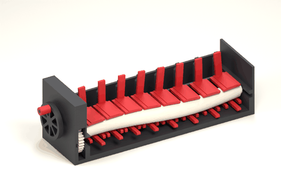
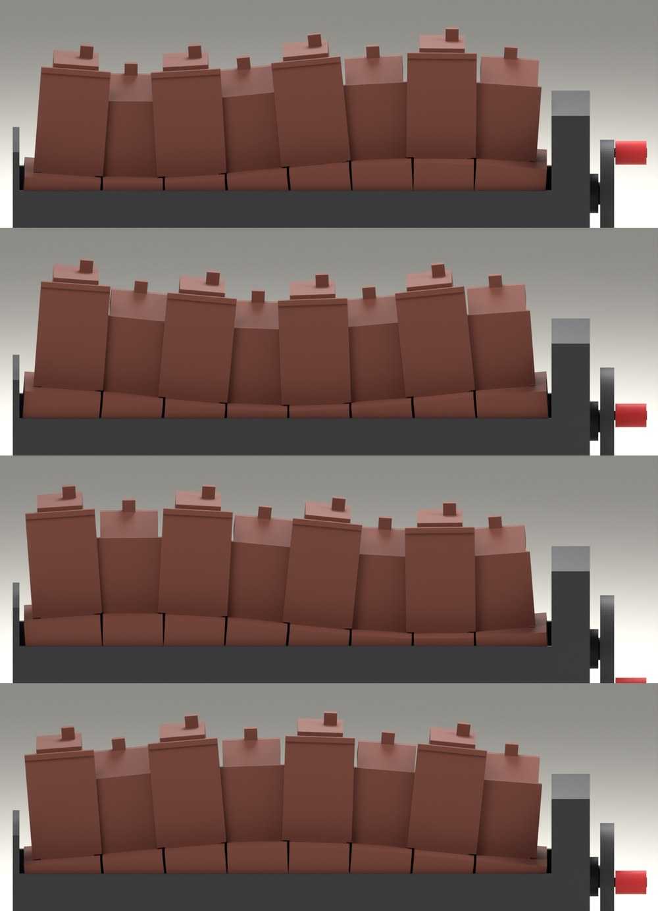
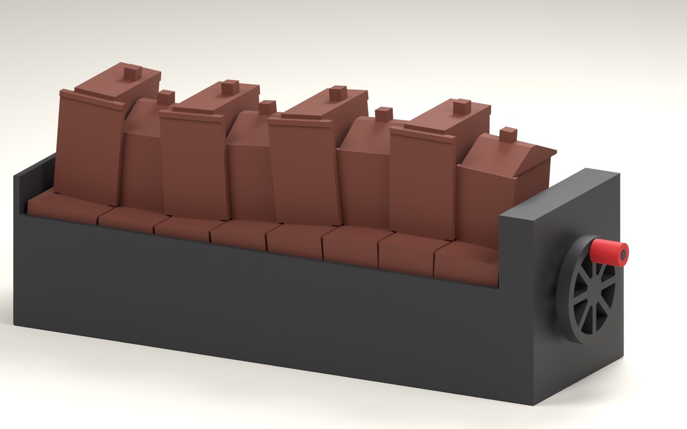
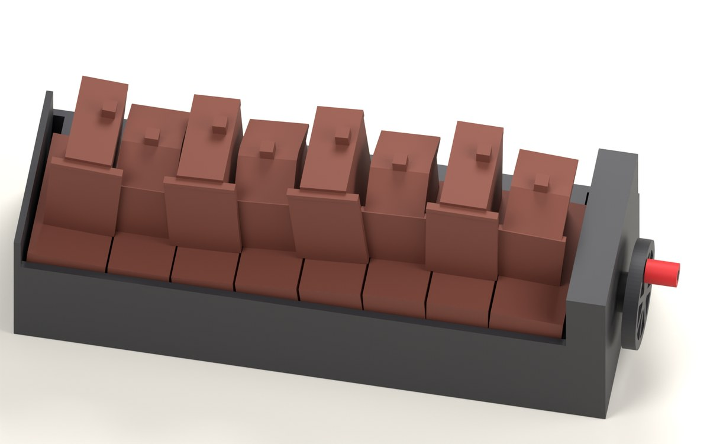
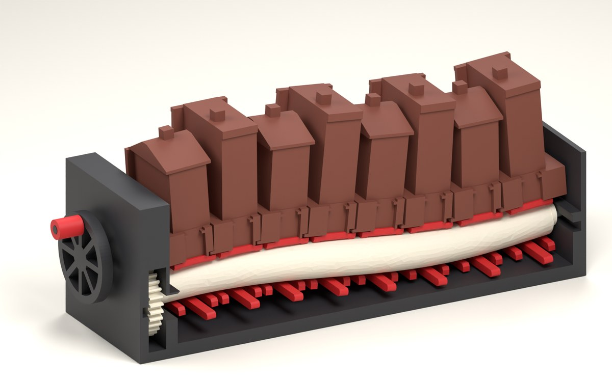
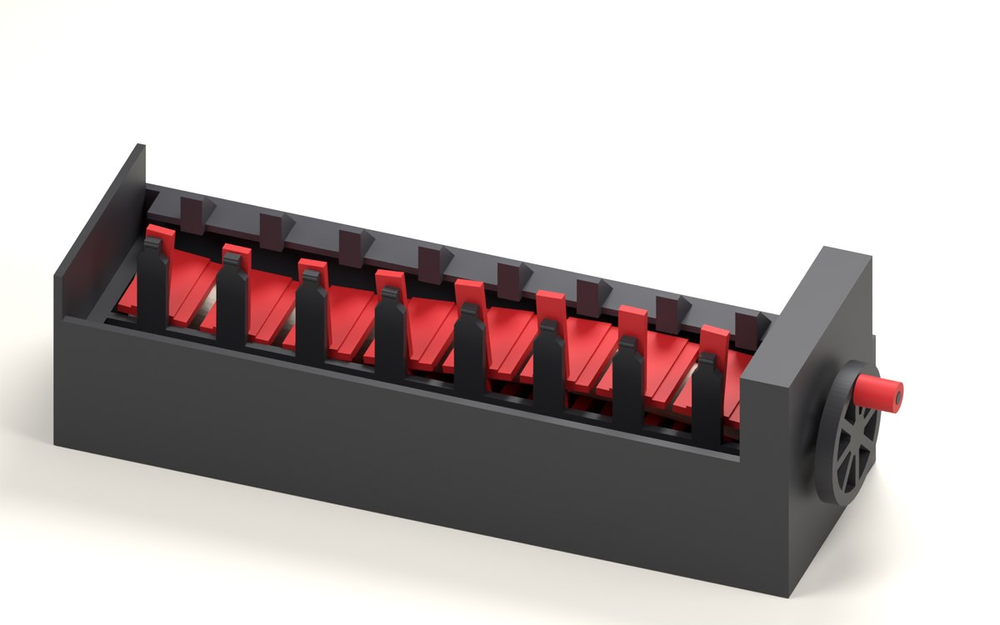

# Fala: motion proof

*Step 3 of the brief. Model `fala` 0.4.0, variant `nikisz`, 2026-11-13. The mechanism is real
geometry with every fit a parameter; the houses are plain volumes that stand in for the
decorated ones. Everything below is a result of the model. Nothing has been printed.*

## Result

In the model, turning the handwheel sends one wave along all eight houses, the same in both
directions, and no part touches another anywhere in the turn. Nothing of the mechanism can be
seen from the front, from three-quarter views or from above. Every part goes in and comes out
along a clear path. The handwheel is light and even as long as friction between the printed
parts stays low.

Three things are not as they should be yet, and they are yours to weigh before the test prints:

1. **Friction is assumed, not measured.** The houses ride by their own weight up to a
   friction of 0.25. Above that the cam has to take them along, which it does up to 0.55, with
   effort that grows and turns uneven. Dry printed PLA may well be above 0.25. The test
   prints have to measure it.
2. **A slit of sky opens and closes at the roofline.** Between the walls of two houses nothing
   ever opens. Above the eaves of a low house, the wing of the tall house beside it and the
   edge of the low roof part by up to 1.9 mm and close again.
3. **A thin slot at pavement level lets light through** when the eye is level with the
   pavement, less than 2 degrees above it. It is 0.5 mm high. A low sill at the back of each
   pavement closes it; I left that for the full design.

There are also seven decisions this work rests on that you have not confirmed. They are
listed at the end.

## The films

Both films loop over one pass of the wave, which is three turns of the handwheel.




The films here are half size. A build writes them in full to `dist/fala/0.4.0/nikisz/`
(`motion.gif`, `mechanism.gif`), with the Blender scene they were rendered from.

The wave at four moments of one pass, a quarter of a pass apart:



| | |
|---|---|
|  |  |
|  |  |

## How it moves

A round bar wound like a corkscrew (the cam) lies under the street and turns on a fixed steel
axle. Each house stands on a printed carrier (the sled) that rests on the cam with two
rounded pads and has two more pads under the cam, so the cam can neither drop a house nor
leave it behind. A fixed blade in front of the cam and the rear panel behind it keep each
house upright and in its place along the street. The house leans about a point just below
its pavement, so the pavement stays one ribbon. A handwheel turns the cam through a 3:1 gear
pair.

Printed parts: 22 (base, rear panel, cam with its gear, pinion, handwheel, knob, 8 sleds, 8
houses). Bought: one 4 x 200 mm steel axle so far. Size 224 x 67 x 93 mm.

## What the brief asks of this step

| The brief asks | The model shows | How it was checked |
|---|---|---|
| Full rotations in both directions, no collisions | No two parts overlap at any of 72 positions through one pass, one every 15 degrees of the handwheel. A position is the same whichever way it is reached, so this holds for both directions | Exact intersection of all 23 solids at each position |
| Effort stays even | With friction up to 0.25: 0.08 to 0.13 N at the knob through the turn, the same forward and back. See "Effort" for higher friction | Force model: every contact of every house at 72 positions, in both directions |
| The wave reads as the look brief intends | Rise, lean, spacing and speed are those of the look brief. See "The wave" | Exact poses from the cam's geometry |
| A short animation of the bare mechanism | The second film above | Rendered from the CAD solids; only rigid motion is animated |

The brief's definition of done has three more points that this step can already answer:
the mechanism is hidden, no gaps open between houses, and the piece can be assembled and
serviced. They follow below.

## The wave

| | Look brief | Model |
|---|---|---|
| Rise and fall of a house | 7 mm | 6.8 mm |
| Lean | up to 6 degrees each way | 6.0 degrees each way |
| Chimney tops | swaying about 5 mm | 4.7 mm each way on a tall house, 4.2 mm on a low one |
| Phase between neighbours | 38 degrees | 38.25 degrees |
| Handwheel turns for one pass | three | three |
| Pavement | one ribbon, slab edges always meet | joint 0.71 to 0.94 mm wide (0.8 at rest), edges level within 0.15 mm |
| Joints between house walls | open and close by 1.8 mm each way at the eaves | walls never open; see "Between the houses" |

Turning the handwheel clockwise, seen from its side, sends the wave away from it. Turning it
back sends the same wave the other way.

## Effort

The force model balances each house on its contacts with friction and gives the torque at
the handwheel. The same friction is assumed at every contact. Force is at the knob, 14.5 mm
from the handwheel's centre.

| Friction | The cam has to pull a house | Torque at the handwheel | Force at the knob |
|---|---|---|---|
| 0.1 | never | 0.5 to 1.0 N mm | 0.04 to 0.07 N |
| 0.2 | never | 1.0 to 1.6 N mm | 0.07 to 0.11 N |
| 0.25 | never | 1.2 to 1.9 N mm | 0.08 to 0.13 N |
| 0.3 | in 0.4 % of positions | 1.4 to 2.2 N mm | 0.10 to 0.15 N |
| 0.35 | in 6 % | 1.7 to 2.5 N mm | 0.12 to 0.17 N |
| 0.45 | in 18 % | 2.3 to 3.4 N mm | 0.16 to 0.23 N |
| 0.55 | in 28 % | 2.9 to 6.0 N mm | 0.20 to 0.42 N |
| 0.6 | 2 of 1152 house positions have no balance | | |

A position here is one house at one handwheel angle in one direction: 8 houses, 72 angles,
both directions.

Up to a friction of 0.25 every house rides on the cam by its own weight and sits against
both of its guides, so nothing rattles in its clearance. From about 0.3, in part of the
turn, a house's weight is no longer enough to make it follow: the cam then takes it along
with the lower pads. At 0.6 the model finds positions with no balance at all: there a
house would stick.

At a friction of 0.25 the force at the knob swings by about a fifth either side of its mean
through the turn, which is 0.04 N from lowest to highest. Forward and back differ by 3 %.
For scale, 0.13 N is the weight of 13 g. The loads are small because a house with its sled
weighs 15 to 18 g.

These figures rest on two assumptions: the mass of a house (taken as 30 % of its solid
volume) and the friction itself. Figures quoted for dry printed PLA on PLA run from about 0.2
to 0.5; I did not check a source for this project.

## Hidden mechanism

The brief asks that whatever moves the houses is invisible from the front, from
three-quarter views and from above at counter height.

At 12 positions through one pass, from 152 directions (from 70 degrees left to 70 degrees
right, and from level with the pavement to 60 degrees above it), no point of the cam, the
sleds, the pinion, the axle or the guide blades is in view. The check casts rays at points
1.2 mm apart on those parts.

The back shows a small fin behind each house; the underside is closed by the base.

## Between the houses

**Walls.** Seen straight on, the wing of a tall house always covers the edge of the low
facade beside it: by 1.9 mm at rest, and by 0 to 3.9 mm through the turn. It only just
closes, with 0.006 mm to spare, at the top of the low facade when the two lean furthest
apart. At 12 positions and from 105 directions, no line of sight passes between the walls of
two houses.

**Roofline.** Above the eaves of a low house there is no wall behind the tall house's wing,
only the edge of the low roof, which stands 0.5 mm behind the wing at rest. When the two
houses lean apart, a slit of sky up to 1.9 mm wide and about 8 mm tall opens between
them, and closes again as the wave moves on. It is where the roofline steps down, and the
look brief expected joints to work by 1.8 mm at the eaves. It can be seen in the phase
pictures above. If you want it closed, the full design can give the tall houses a gable
wall that stands behind the wing, above the low roof.

**Pavement level.** The outer parts of each facade plate stand 0.5 mm clear of the pavement,
so that they can pass over the neighbour's slab. Behind the plates the gap between two
houses is open to the back. With the eye level with the pavement and up to 5 degrees to
either side of straight on, light passes through this slot, at every position of the wave.
The check finds nothing with the eye 2 degrees above the pavement or 10 degrees to the side:
from there the pavement or a house closes it. A sill 1.5 mm high along the back edge of each
pavement would close it from every angle. This is a change to the ground block, so I did
not make it in this step.

**From above.** The bodies of two houses stand 3.8 to 5.5 mm apart behind the facade plates,
because their tops need room to lean towards each other. From above, the viewer looks down
between them onto the pavement. No mechanism shows there. Whether the decorated houses
should close this (for example with roofs that lap) is a question of the look, for the full
design.

## Assembly and service

The order, each step along a path that is clear in the model:

1. The eight sleds, from above.
2. The cam on its axle, from the back, into the open jaws of the sleds.
3. The rear panel, from the back. It holds the axle in.
4. The eight houses, from above, starting at the end away from the handwheel.

A house goes in while its sled stands at the top of the wave. There the sled is upright, so
the house comes straight down, and the house on its left leans away from it. A third of a
turn of the handwheel brings the next sled to the top. The position need not be exact: a
house goes in clear from 40 degrees of the handwheel before the top to 140 degrees past it.

A house comes out the same way, after the houses on its right: each ground block lies over
a lap of the block on its left. To reach a sled or the cam, the houses and the rear panel
come off. No glue anywhere.

Not timed, and four things are not designed yet: how a house holds on its sled, how the
pinion and the knob are kept on, the rear panel's screws, and the look of the two bookends.

## What this step does not prove

- **Friction and mass** are assumptions (above).
- **Nothing dynamic.** The model is static: it says nothing about fast cranking, noise,
  rattle or wear over 10,000 turns. Those are for the test prints.
- **Heat** is addressed by design only (steel axle, no preloaded snap fits, running
  clearances of 0.3 to 0.4 mm), not tested.
- **Print quality of the fits.** The cam stands 190 mm tall on the bed; the rear panel
  prints on its outer face. Both are to confirm on the U1.
- **The look.** The houses are plain volumes: the largest shapes that move without touching.
  The decorated houses have to stay inside them.

## Decisions to confirm

1. **Look 1 "Nikisz" and drive A, the corkscrew.** The model is built on both. Your approval
   is recorded only on the branch that was set aside, and the look brief had recommended
   Look 2.
2. **Three turns of the handwheel for one pass of the wave** (the look brief's
   recommendation, never answered).
3. **The base is 67 mm deep.** The concept had 60; the brief allows about 70.
4. **A small fin behind each house shows from the back.**
5. **Two of the eight houses are end-of-terrace parts,** not interchangeable with the other
   six: their pavement runs on to the bookend, so the street has no open end.
6. **Lubricant.** If the test prints measure a friction above about 0.25, is a dry PTFE
   lubricant or a plastic-safe grease on the cam and the guides acceptable for the product?
7. **The roofline slit:** accept it as the roofline working, or close it in the full design?

## What comes next

With your approval, step 4: a small set of test parts for the U1 that measure friction on
its own surfaces and check the riskiest fits (pads on the cam, a sled in its guide, the gear
pair), plus one sample house section for the look.

## To reproduce

```
uv run pytest projects/fala                                  # 27 tests, about 2.5 minutes
uv run cadkit build fala -v nikisz --animate                 # exports, stills, both films
uv run python projects/fala/tools/motion_proof.py checks     # every figure quoted here
uv run python projects/fala/tools/motion_proof.py assets     # the pictures in this document
```

The figures are stored in `docs/motion-proof-checks.json`. The reasoning behind the design,
and what was tried and dropped, is in `docs/design-notes.md`.
