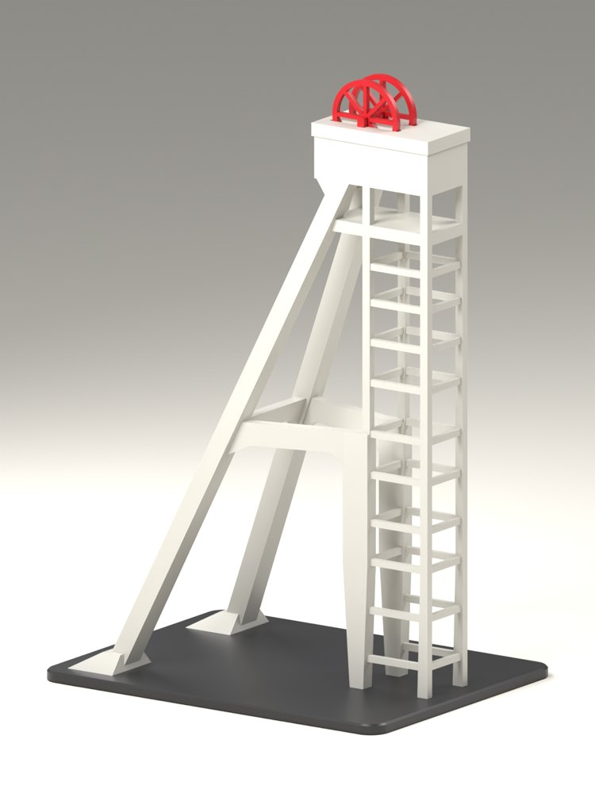
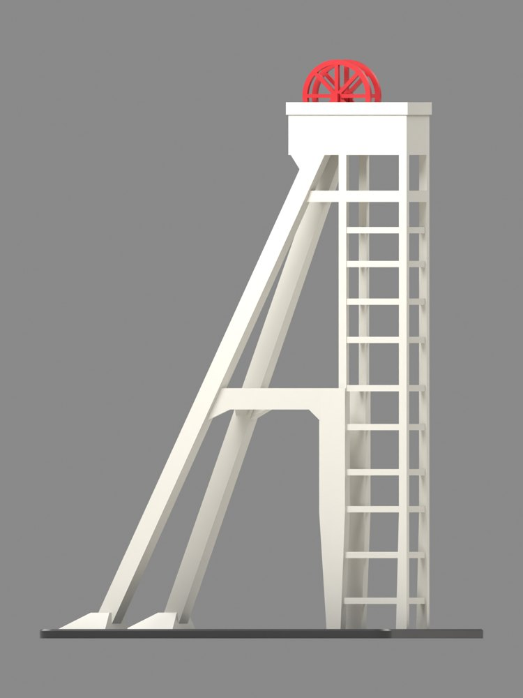
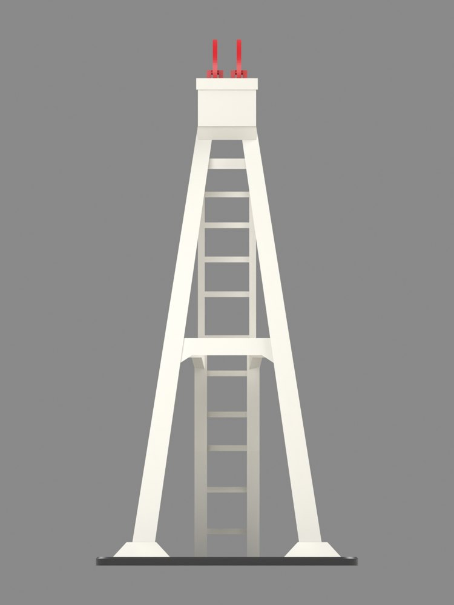
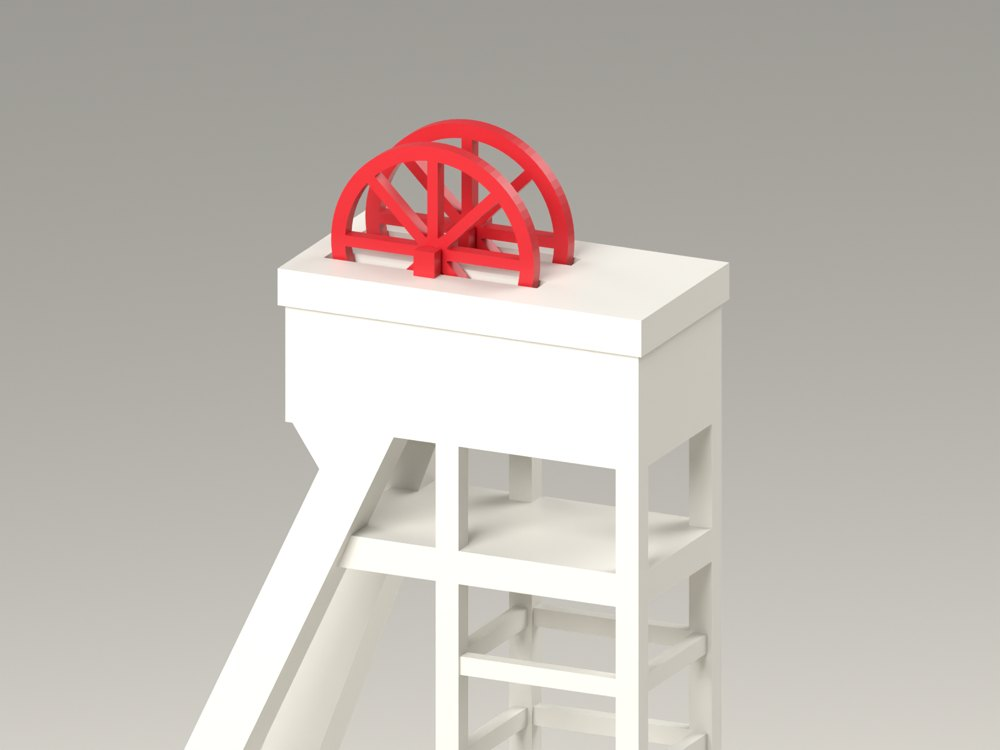

# Szyb Prezydent

A scale model of the reinforced-concrete headframe of the Prezydent shaft in Chorzów (1933),
meant as a printed souvenir. Everything for this product lives in this folder.

## Status (2026-11-14, first session)

**Stage 1 is done and accepted: the shaft is chosen, its dimensions are established, and the
structure is built in CAD at 1:250 (`prezydent` 0.1.0, variant `s250`). Nothing is printed.**

The client was given the choice (Prezydent over Warszawa II in Katowice and Krystyna in
Bytom), the answer on scale, the case as a souvenir and the stage-1 model on 2026-11-14, and
answered "perfect, document this, commit, push". The choice of shaft stands. Stage 1 is in the
commit that holds this file.

| | |
|---|---|
|  |  |
|  |  |

What exists:

- Four parts: `concrete` (the whole 1933 structure, one solid), `sheave_1`, `sheave_2` and a
  plain `base`. 168 mm to the sheave deck, about 185 mm overall, on a 120 × 92 mm plinth.
- The real tower is described once, in metres, in `Prototype` in
  [`src/prezydent/model.py`](src/prezydent/model.py). `Params.scale` turns it into a print;
  `fidelity()` reports which members had to be thickened.
- At 1:250 every concrete member is at its true size. The sheaves are thickened (1.32 mm
  would be true, 1.6 mm is printed).
- 5 tests pass: the snapshot, no part intersects another, the concrete is true to scale at
  1:250, a smaller scale thickens the beams, the height follows the scale.
- [`docs/research.md`](docs/research.md): why this shaft, the sources, how the dimensions
  were measured from photographs, what does not agree, and the case for it as a souvenir.

What is not as it should be yet:

1. **The scale rests on photographs.** Published: deck at 42 m, footings 21 m out, struts
   15 m apart, sheaves 5.5 m. Everything else is measured from three photos to about ±5 %,
   and the photos disagree with the record on three points (research, section 3). One length
   measured on site would settle it: the trunk should be 5.8 m by 5.1 m, outside to outside.
2. **It is a structure, not yet a product.** No railings, no crane beam over the sheaves, no
   name on the plinth; the box under the deck is solid (research, section 5).
3. **No print strategy.** As modelled, the sheaves hang in their slots with clearance and
   stand on two small pedestals, which cannot be printed in place without support. The
   terrace and the box start as bridges between four posts. None of this has been through a
   slicer.
4. **Rights and market are unchecked** (research, section 6).

## Next

In this order, each a stage of its own:

1. Print strategy and a first test print: upright in one piece or split, how the sheaves
   are made and fixed, what the bridges do. This decides whether the head stays solid.
2. Detail that makes it a product: railings, the crane beam, the plinth with the name and
   year, perhaps the brick panel; a second variant if a smaller size is wanted.
3. A measurement on site, whenever someone is in Chorzów.

The client has not said which of these comes first; ask at the start of the next session.

## Build and inspect

From the repository root:

```sh
uv sync --all-packages
uv run cadkit show prezydent -v s250          # OCP viewer
uv run cadkit build prezydent -v s250 --render
uv run pytest projects/prezydent/tests
```

Output goes to `dist/prezydent/0.1.0/s250/` (gitignored). The images in `docs/img/` are
reduced copies of those renders; refresh them after a geometry change.

Axes: X from the shaft towards the strut feet (west on site), Y across (+Y is south), Z up.
