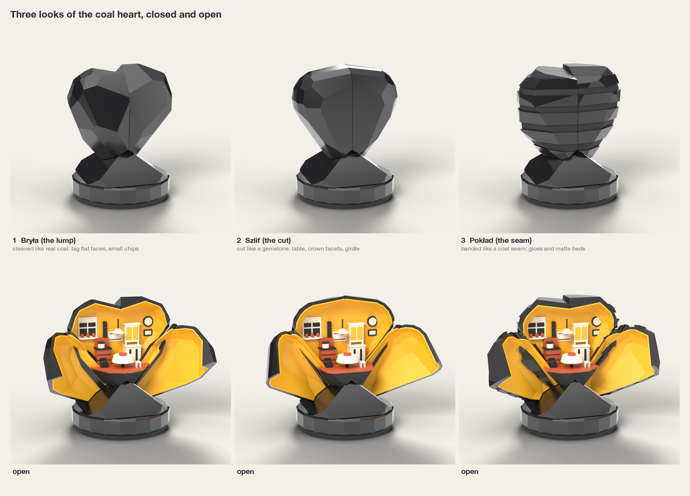

# Serce na węgiel

A coal heart that opens to reveal a warm Silesian kitchen. Product requirements live in
[the original brief](docs/brief.md).

**Current stage: CAD motion prototype.** On 2026-11-12 the user approved **Bryła + two wings
(A) + honey lining**. The repository contains the concept research and a build123d prototype
under `src/serce/`. There is no production release or validated print plate yet.

The [motion prototype and first U1 fit tests](docs/motion-prototype.md) describe the CAD,
361-position interference check and remaining mechanical work. The workspace passes 101 tests.

```sh
uv run cadkit show serce -v motion_open
uv run cadkit build serce --all
uv run cadkit build serce-coupons --all
```

Generated CAD: `dist/serce/0.1.0/`. Fit-test layouts: `dist/serce-coupons/0.1.0/`.
The looping motion preview is `dist/serce/0.1.0/motion_closed/motion.gif`.

Start with the [look brief and opening comparison](docs/look-brief.md), then the
[22 annotated research references](research/references.md). The recommendation is **Bryła +
Skrzydła (A), honey lining, four PLA colours**. The look, opening and lining choice is approved.



All geometry is authored in build123d: `src/serce/model.py` holds the motion prototype and
`concept/heart_concept.py` holds the earlier look studies. Blender imports the CAD
meshes for presentation only. The current massing STL files are not manufacturing files.

## Reproduce the checkpoint

Run from the workspace root with the existing uv environment:

```sh
uv run python projects/serce/concept/look_concepts.py --no-show
MPLCONFIGDIR=/private/tmp/serce-matplotlib uv run python projects/serce/concept/mechanism_diagrams.py
/Applications/Blender.app/Contents/MacOS/Blender --background --factory-startup --python projects/serce/concept/render_blender.py
uv run python projects/serce/concept/compose_sheets.py
```

The first command constructs CAD; the second draws explanatory diagrams. The last two commands
are optional presentation steps. Intermediate CAD meshes and renders go into ignored
`concept/_build/`. The checked-in images live in `docs/img/`.

## Next stage

Print the first fit coupons on the U1 and measure the fits. Resolve preload, drag and hardware
retention before adding the finished coal cladding, honey lining and room. The current nominal
motion clears sampled interference checks; feel, holding, wear and heat performance still need
physical evidence.

The [engineering review](docs/look-brief.md#engineering-review) records the unresolved holding,
pinch, heat, stability and manufacturing questions. None has passed physical testing.
