# Serce na węgiel: look brief and concept checkpoint

**Status: approved on 2026-11-13 (step 2 of the brief): Look 1 Bryła, opening A Skrzydła, honey
lining. The decisions are in section 12. Nothing is modelled in detail yet; the next step is the
motion proof, and the engineering reasoning for it is in `design-notes.md`.**

How to view: open this file's preview in VS Code (`Shift+Cmd+V`). The three looks are also live
in the OCP CAD Viewer panel, where you can orbit them. To regenerate everything:

```
uv run python projects/serce/concept/look_concepts.py        # scenes -> OCP viewer + STL files
/Applications/Blender.app/Contents/MacOS/Blender -b --factory-startup \
    -P projects/serce/concept/render_blender.py              # STL files -> renders
uv run python projects/serce/concept/compose_sheets.py       # renders -> sheets in docs/img
uv run python projects/serce/concept/mechanism_diagrams.py   # mechanism diagrams + drive numbers
```

## 1. Recommendation in short

- **Look: 1 "Bryła" (the lump).** A symbolic heart cleaved like a real lump of coal: a few big
  flat faces, many small chips, nothing regular.
- **Opening: A "Skrzydła" (wings).** The two front quarters of the heart swing out and back like
  the wings of an altarpiece. The back half stays whole, so the open piece is still a heart, with
  the room inside it.
- **Drive:** half a turn of the base ring opens it, the next half closes it, in either direction.
  There are no end stops to force.
- **Inside:** a Silesian kitchen with nobody in it and the fire lit: tiled coal stove, coal box,
  white dresser, table with a crocheted cloth, window with geraniums.
- **Palette:** coal black, honey, bone white, tile red. Honey lines the shell.
- **Size:** closed 85 × 77 × 104 mm (width × depth × height, base included); open 133 mm wide.
  About 165 g of PLA and, if you agree, 150 g of steel ballast.

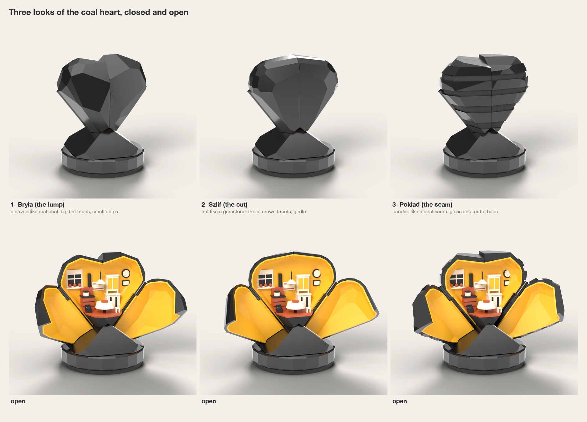

## 2. What the research says

### 2.1 Coal itself

- **Coal reads as coal by its lustre, not its colour.** Bright coal (vitrain) has a "brilliant
  glossy luster" and breaks with a conchoidal, glass-like fracture; dull coal (durain) is
  "hard, compact, dull", grey to dull black [5]. Anthracite is "uniform, hard and shiny, with a
  semimetallic luster" [4]. In every photo the black is carried by flat faces that flash and
  go dark as the lump turns [1][2][3].
- **Coal breaks into flat faces of mixed size with sharp edges.** The Ibbenbüren lump is a pile
  of stepped planes [2]; the Sosnowiec anthracite, from a Silesian-basin mine, pairs mirror-flat
  faces with curved glassy ones [1]. Nothing is rounded and nothing repeats.
- **The carving tradition makes coal precious by polishing it.** Coal carving began among miners
  with "smoothly ground coal cubes" and small relief pendants. The Rydułtowy school (from 1945)
  settled on realistic figures with a "smoothed and polished surface". The article describes
  mixed tooling that leaves a varied surface which "reflects light in a very interesting way" [6].
  The Panewniki St Barbara shows the result: no colour at all, form carried by highlights [7].
- **What to take:** flat facets, crisp edges, mixed sizes, and a black with some sheen on the big
  faces. Black PLA cannot be glassy, but a flat facet gives one clean highlight, and that is what
  the eye reads as coal. Which black filament does this best has to be settled on a printed
  sample (section 11).

### 2.2 The heart form

- The symbolic heart is the only form that reads at a glance. Its shape has been fixed since the
  Middle Ages and has meant love since the 15th century; it is "not an anatomically correct
  representation of a heart" [9]. An anatomical heart needs vessels, asymmetry and colour to be
  recognised [11]. At 80 mm in black it would read as a lump, or as something medical.
- A heart survives faceting well. The heart-cut gemstone keeps three things: the cleft, the point
  and a clear outline (girdle) [10]. Keep those three and everything else can be rough.
- **What to take:** symbolic heart, slightly lopsided so it looks found rather than drawn. The
  surprise comes from the material and from the opening, not from an unusual heart.

### 2.3 The Silesian home

- **The kitchen is the room to show.** Bonclok calls it the symbol of the household hearth, and
  the coal stove stands in it, which is the joke of the piece [13]. The museum flat in Nikiszowiec
  shows the period 1930s to 1960s, in a flat of "a kitchen entered from a mudroom and two
  rooms" [12].
- **The objects that say "Silesian kitchen"** [13][14]: the *byfyj*, a dresser painted white with
  a glazed upper part; the tiled coal stove (*piec kaflowy*) with steel cooking plates; the
  *ryczka*, a small stool in front of the stove; the *kołkastla*, a coal box with shovel and
  poker; geraniums (*muszkaty*) in the window; a *makatka*, an embroidered hanging with a motto,
  above the table; white crocheted trim (*szpicki*) on the shelves.
- **Colours** in the museum photos [12] and Bonclok's stove photo [13]: kitchen furniture is white
  or cream; the best room has honey-yellow walls and brown burr-wood furniture; stove tiles are
  orange-brown; textiles are white lace. Early makatki are blue thread on white [14].
- **People or signs of them:** signs only. A figure 8 mm tall would print as a blob, and an empty
  room with the fire lit and a cake on the table invites the viewer in.

### 2.4 Reveals that delight

- **Plain outside, rich inside.** The first Fabergé hen egg is a plain white enamelled shell,
  64 mm tall, made "to look like a real egg". It opens with a twist and shows a matte gold yolk,
  then a hen [16]. The plainer the shell, the bigger the surprise.
- **Hide the seam in the pattern.** A closed Japanese puzzle box shows no joint because its joints
  run along the lines of its marquetry [17].
- **Pace it.** The opening should have a first moment (a line of light), a middle (a glimpse) and
  an end (the whole scene, framed). Flower lamps tie the amount of light to how far the petals
  have opened [18].
- **What to take:** an austere black shell with no hint of a door; seams that look like the
  material's own cracks; a hairline of warm colour first; the room framed by the open shell.

### 2.5 What looks good printed

- **The printer.** The U1 has four toolheads, 270 × 270 × 270 mm, and changes tool in about 5 s
  by the maker's figure; it still builds a small prime tower, and it calibrates the offsets
  between toolheads to within 0.04 mm (maker's claims) [19]. A hands-on review found "clean
  color transitions" on multi-colour prints under 100 mm and called the tower "the only
  noticeable waste" [20].
- **Facets suit FDM.** On a real faceted print the layer lines show as fine contour lines on
  shallow faces and vanish on steep ones, and edges stay crisp [21]. This also resembles the fine
  bedding of coal, so I treat it as part of the look.
- **Small features.** Vertical pins under 5 mm are weak and "susceptible to breaking"; overhangs
  print cleanly to about 45°; bridges mark unless shorter than 5 mm [22]. Furniture therefore has
  to be chunky blocks with relief, not thin legs and rails.
- **Black filament.** Matte PLA hides layer lines best; sources disagree on whether a glossy or
  silk black hides or exaggerates them [23]. Coal needs some sheen, so this is a test-print
  question.

### 2.6 The market

- **Coal lumps on stands** exist: Artis sells a raw lump on a plinth with an engraved plate
  ("Konsek ślonskij ziemi") and grave hearts coated in coal, priced by quote [24].
- **Coal jewellery** is the premium end: bro.Kat sets small lumps in silver (heart earrings
  165 zł) and calls the cut lump a "coal diamond"; I Coal You sells a coal heart necklace and
  quotes a local saying, "Silesian girls have coal where their hearts should be" [25].
- **Carved figures** (Skarbnik, St Barbara, miners) cost 280 to 1,200 zł; a 26 cm graphite
  Skarbnik is 870 zł [8].
- **Nobody sells** a coal heart that opens, anything with an interior, or anything kinetic. The
  existing coal hearts are raw, sentimental or funerary. This piece differs by its precision, its
  mechanism and its humour, and it can sit in price between the jewellery and the carved figures.

## 3. References

Photos are real photographs, not renders. Each line says what to take. Local copies and contact
sheets are in `research/`; sources and licences are in `research/SOURCES.md`.

**Coal**
1. [Anthracite from the Bolesław Chrobry mine, Sosnowiec museum](https://commons.wikimedia.org/wiki/File:Anthracite_from_Boleslaw_Chrobry_(Sosnowiec_Museum).jpg): black glass with curved fracture next to flat faces. The lustre to aim for.
2. [Anthracite lump, Ibbenbüren](https://commons.wikimedia.org/wiki/File:Ibbenbueren_Anthracite.JPG): stepped flat planes of mixed size meeting at sharp edges. The facet language of Look 1.
3. [Bituminous coal, Tabasco mine](https://commons.wikimedia.org/wiki/File:Bituminous_coal_(Tabasco_Mine,_Trinidad_Coal_Field,_Colorado,_USA)_1_-_54578656078.jpg): dull, blocky, bedded. The source of Look 3 and the reason it reads less precious.
4. [Sand Atlas, "Anthracite - Types of Coal"](https://www.sandatlas.org/?p=13941): "uniform, hard and shiny, with a semimetallic luster"; 8 cm samples photographed plainly.
5. [Kansas Geological Survey, Bulletin 102, classification of coal](https://www.kgs.ku.edu/Publications/Bulletins/102_1/03_class.html): bright bands are glossy and break like glass, dull bands are matte. Gloss against matte is the contrast inside coal.

**Coal carving**
6. [K. Braun, "Święta Barbara z węgla", Rocznik Mazowiecki 25 (2013), pp. 286-292](https://bazhum.muzhp.pl/media/texts/rocznik-mazowiecki/2013-tom-25/rocznik_mazowiecki-r2013-t25-s286-292.pdf): history and technique of Silesian coal carving. Polished planes are what make coal precious.
7. [St Barbara in coal, Franciscan monastery, Katowice-Panewniki](https://commons.wikimedia.org/wiki/File:20221213_Saint_Barbara_in_coal.jpg): a satin black figure with no colour; relief and highlights do all the work.
8. [Pamiątki Górnicze, carved figures](https://pamiatkigornicze.pl/kategoria/rzezby-z-wegla/): today's carved souvenirs and their prices; figurative and solemn, which this piece is not.

**Heart**
9. [Heart symbol, Wikipedia](https://en.wikipedia.org/wiki/Heart_symbol): two lobes, a cleft, a point; fixed since the Middle Ages.
10. [Heart-cut gemstone rings](https://commons.wikimedia.org/wiki/File:Heart_Shape_Rings.jpg): how a faceted heart stays a heart: cleft, point, girdle. The source of Look 2.
11. [Anatomical heart model, Deutsches Hygiene-Museum](https://commons.wikimedia.org/wiki/File:Dresden,_Deutsches_Hygiene-Museum,_anatomisches_Modell,_Herz.jpg): what to avoid: needs colour and vessels, reads medical.

**The home**
12. [Muzeum Historii Katowic, "At our home in Nikisz"](https://mhk.katowice.pl/en/permanent-exhibitions/at-our-home-in-nikisz-inside-a-nikiszowiec-flat/): the reconstructed flat and its photo gallery: white kitchen, yellow best room, lace, enamel, holy pictures.
13. Bonclok.pl, [kitchen furnishings](https://bonclok.pl/slaskie-tradycje/codziennosc/259-wyposazenie-tradycyjnej-kuchni.html) and [the stove](https://bonclok.pl/slaskie-tradycje/codziennosc/256-piec-nie-tylko-do-ogrzewania.html): the inventory with its Silesian names: byfyj, piec kaflowy, ryczka, kołkastla, muszkaty.
14. Bonclok.pl, [makatki](https://bonclok.pl/slaskie-tradycje/codziennosc/428-haftowane-makatki-z-madrosciami-domowymi.html) and [the byfyj](https://bonclok.pl/slaskie-tradycje/codziennosc/429-w-antryju-na-byfyju-stoji-szolka-tyju.html): the hanging above the table, blue on white; the white dresser with glazed top and crocheted trim.
15. [Museum kitchen photos IMG_5198 to IMG_5224](https://mhk.katowice.pl/en/permanent-exhibitions/at-our-home-in-nikisz-inside-a-nikiszowiec-flat/) (same gallery): the kitchen wall as a composition: dresser, shelf, small objects in a row. The layout of the back wall.

**Reveals**
16. [First Hen egg, Fabergé, 1885](https://en.wikipedia.org/wiki/First_Hen_(Faberg%C3%A9_egg)) ([photo](https://commons.wikimedia.org/wiki/File:First_Hen_(Faberg%C3%A9_egg).jpg)): plain shell, twist to open, warm matte gold inside, surprise in stages.
17. Japanese puzzle box, [closed](https://commons.wikimedia.org/wiki/File:Japanese_puzzle_box_(yosegi)_-_closed.jpg) and [opened](https://commons.wikimedia.org/wiki/File:Japanese_puzzle_box_(yosegi)_-_opened.jpg): joints hidden along the lines of the surface pattern.
18. [Flower lamp, patent US4910647](https://patents.google.com/patent/US4910647): petals open gradually and the light grows with the opening. A principle only.

**Printing**
19. [Snapmaker U1, maker's page](https://www.snapmaker.com/en-EU/snapmaker-u1): the machine's limits and claims.
20. [3DWithUs, hands-on with the U1](https://3dwithus.com/snapmaker-u1-hands-on-toolchanging-3d-printer): real multi-colour prints under 100 mm; clean transitions; a 0.16 mm keychain took over 7 hours.
21. [Low-poly Stanford bunny, printed](https://commons.wikimedia.org/wiki/File:Low_Poly_Stanford_Bunny.jpg): how facets really print: contour lines on shallow faces, clean steep faces, crisp edges.
22. [Hubs, "How to design parts for FDM 3D printing"](https://www.hubs.com/knowledge-base/how-design-parts-fdm-3d-printing/): thin pins break, 45° overhangs, 5 mm bridges, chamfers at the plate.
23. [Snapmaker, "PLA Matte vs. Basic"](https://www.snapmaker.com/blog/pla-matte-vs-basic/): matte hides layer lines; the trade against sheen.

**Market**
24. [Artis, coal on a stand](https://www.artis-pamiatkigornicze.pl/oferta/wegiel-na-podstawce): the existing coal souvenir: a raw lump, a plinth, an engraved plate.
25. Coal jewellery: [bro.Kat heart earrings, 165 zł](https://teatrslaski.art.pl/sklep/kolczyki-z-weglem-serca-bro-kat/) and [Euronews on I Coal You](https://www.euronews.com/2025/01/28/how-polands-historic-upper-silesia-coal-mining-region-is-turning-towards-jewellery): the premium end; coal as a small, cut, precise object.

## 4. Recommended form, surface and stylisation

**Form.** A symbolic heart 82 mm wide, 82.5 mm tall and 46 mm deep, with a clear cleft, straight
V flanks and a point that sinks into a low mound of coal. The flanks are straight on purpose: the
hinges of opening A lie along them. Each flank is a shallow ridge where two facets meet at 144°,
and the ridge is rounded to a 2 mm radius because the hinge pin runs inside it. The left and right
halves are cleaved differently, so the silhouette is a heart but the lump is not symmetrical.

**Surface.** Flat facets only, with crisp edges and no fillets. About 30 facets on each half: a
dozen broad faces of 15 to 37 mm, as coal breaks, and smaller chips of 4 to 14 mm between them.
Every facet is one plane laid against a smooth heart and pushed in, so the wall and lining
offsets stay exact.

**Seams.** Coal cracks along two sets of straight planes at right angles (cleat). The piece has
exactly two seam planes at right angles: the centre plane and the plane between front and back.
Each seam is a 0.3 mm groove, and two or three false grooves of the same width run parallel to
each set, so the real seams are two cracks among several.

**Base.** A faceted mound of coal under the point, on a 76 mm ring with 20 flats that is the grip
for turning, on a slightly smaller foot. The mound's two main faces are square to the hinges, so
the shells sweep 0.4 mm above them and no gap ever closes on a finger.

**Rules that printing sets on the look** (a 0.4 mm nozzle; to be confirmed by test prints):

| Feature | Rule |
|---|---|
| Facet | Flat, at least 4 mm across |
| Raised or sunk detail | At least 0.9 mm wide, 0.4 to 0.8 mm deep |
| One colour set into another | At least 1.2 mm wide |
| Groove that must stay open | At least 0.5 mm wide |
| Free-standing post | At least 2 mm thick, no taller than four times its thickness, widened at the foot |
| Light colour over black | At least 1.2 mm thick, or the black shows through |
| Visible face that points downwards in the print | No flatter than 40° from the plate, so it needs no support |
| Overhang anywhere | 45° at most |

Furniture is therefore solid blocks with relief, drawn tall and chunky, at roughly 1:60.

## 5. The interior scene

One room, the kitchen, seen as a stage: a back wall, a floor, and furniture standing against the
wall and in front of it. From left to right:

1. **Window** in the left lobe, with white frame, dark panes and three red geraniums on the sill.
2. **Tiled stove** (tile red) with a black iron top, a pot, a stove pipe, and a fire door with a
   honey slot: the fire is lit. This is the one-line joke made visible.
3. **Coal box** in front of the stove, heaped with black lumps, the same black as the shell.
4. **Makatka** above the table, a white panel with two red bands. Real early ones are blue on
   white [14]; there is no fifth colour, so it is drawn in red.
5. **Table** with a white crocheted cloth and a cake, and a stool beside it.
6. **Byfyj** (white dresser) with a glazed upper part that glows honey.
7. **Clock and a picture** in the right lobe.

No figures. By default no cross above the door and no holy pictures, although both are authentic
[12][13]: on a wry souvenir for foreign visitors they could read as mockery. Say so if you want
them.

The first hairline of the opening falls on the centre of the room. That is where the white
tablecloth stands against the honey wall, so the first thing seen is the brightest.

## 6. Palette

Four filaments make the whole piece. No part uses more than four.

| Colour | Hex in the renders | Where | Why |
|---|---|---|---|
| Coal black | `#17171A` | Shell, mound, ring, foot; in the room: stove top, pipe, panes, coal | The material itself. One black inside and out ties the coal in the box to the coal of the heart |
| Honey | `#EDAE1C` | Room walls, lining of the shell, the fire, the dresser glass | The warmest strong colour against black, and it stands in for light because there is no lamp. The museum's best room has walls this colour [12] |
| Bone white | `#ECE5D2` | Dresser, cloth, window frame, makatka, pot | White-painted kitchen furniture and lace [12][13][14]. Off-white, because pure white looks cold beside honey |
| Tile red | `#B4502A` | Stove tiles, floor, geraniums, cake | Glazed stove tiles and brick [13]; the only red, so the stove draws the eye |

The shell parts use two colours (black, honey) and the room uses all four. A second black with a
different sheen is possible on the shell without breaking the limit; the coal sample in the test
prints will show whether it is worth it.

**Lining: honey (recommended) or tile red.** Honey makes the open shell glow like a lit window.
Red makes it glow like embers and lets the room stand out more, but it is darker and the open
piece loses some of its contrast with the black.

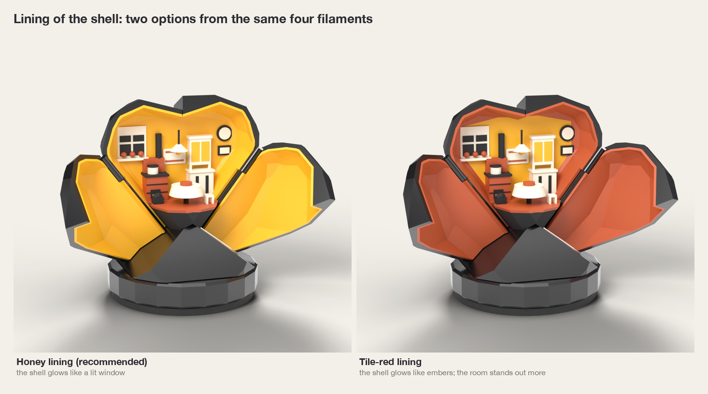

## 7. The opening in visual terms

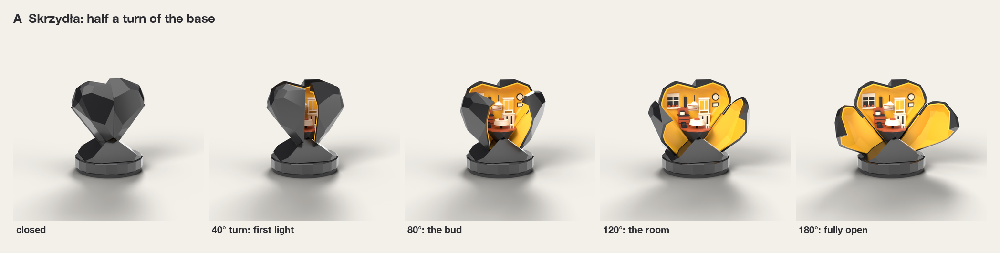

1. **Closed.** A black heart of coal on a mound of coal. Two fine cracks among several.
2. **First light (15° to 40° of turn).** The centre crack widens to a hairline of honey: 1 mm at
   15°, 3 mm at 30°. Nothing else has moved. This is the moment of surprise.
3. **The bud (about 80°).** The crack is a wedge. The table and the stove fire show through it,
   and the lining of both wings catches the light.
4. **The room (about 120°).** The wings stand like half-open shutters. The whole kitchen is in
   view between them.
5. **Fully open (180°).** The wings have swung 125° and lie back beside the heart with their honey
   linings facing the viewer, like the open wings of an altarpiece. The back half is untouched, so
   the outline is still a heart, now with a home in it.

The motion is slow at both ends and quick in the middle. Closing is the same film backwards.

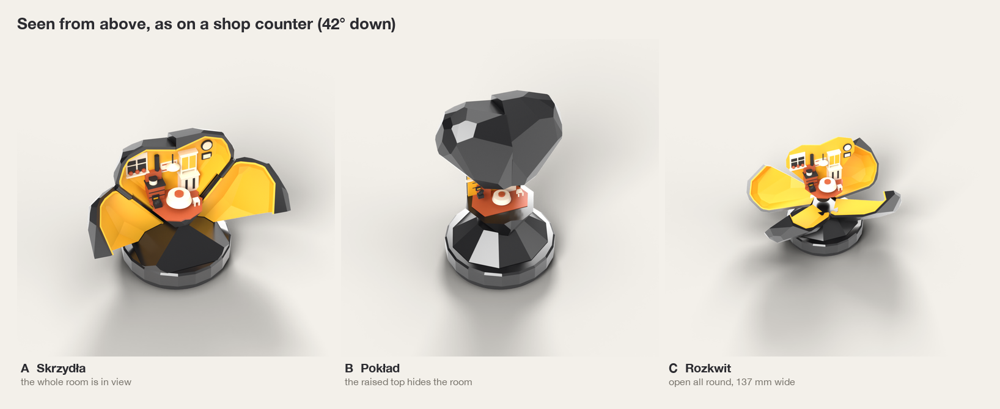

## 8. The three looks

| | 1 Bryła (the lump) | 2 Szlif (the cut) | 3 Pokład (the seam) |
|---|---|---|---|
| Idea | Cleaved like real coal [1][2] | Cut like a heart gemstone [10]: table, crown facets, girdle | Banded like a coal seam [3][5]: bright and dull beds |
| Reads as coal | **Strongest** | Reads as a black gem first | Reads as a stack of slabs |
| Reads as a heart | Clear | **Clearest**, most symmetrical | Weakest; the bands fight the outline |
| Hides the seams | **Best**: irregular faces and false cracks | Worst: symmetry makes any misfit obvious | Good for a horizontal seam, poor for the centre seam |
| Printing | Mixed facets hide layer lines and small flaws | Large regular facets show every flaw | Bands follow the layers, which is easy, but the steps collect dust |
| Tone | Wry: an honest lump | Glamorous; "black diamond" is a cliché here | Geological, serious |

**Why Bryła:** it is the look a foreign visitor will read as coal without a caption, it is the
most forgiving to print, and it hides the seams best. It also leaves the surprise to the opening
rather than to the outside.

| Closed | Open |
|---|---|
| 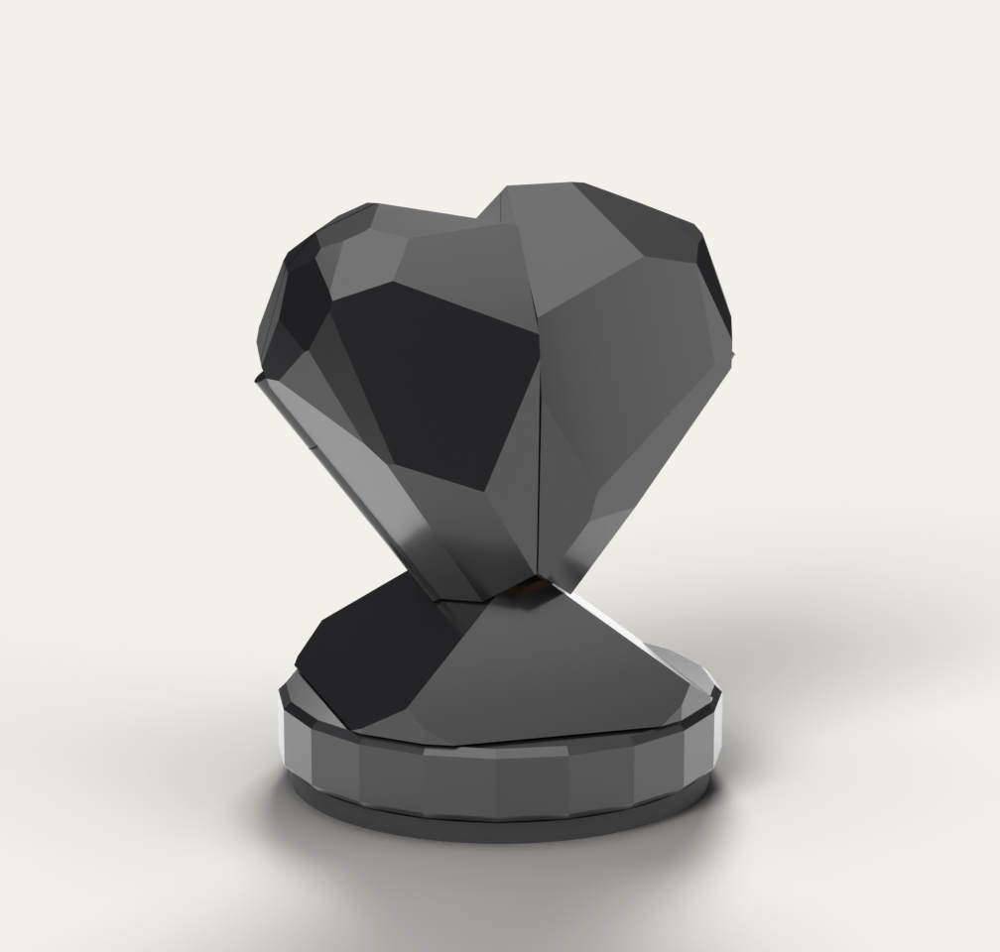 | 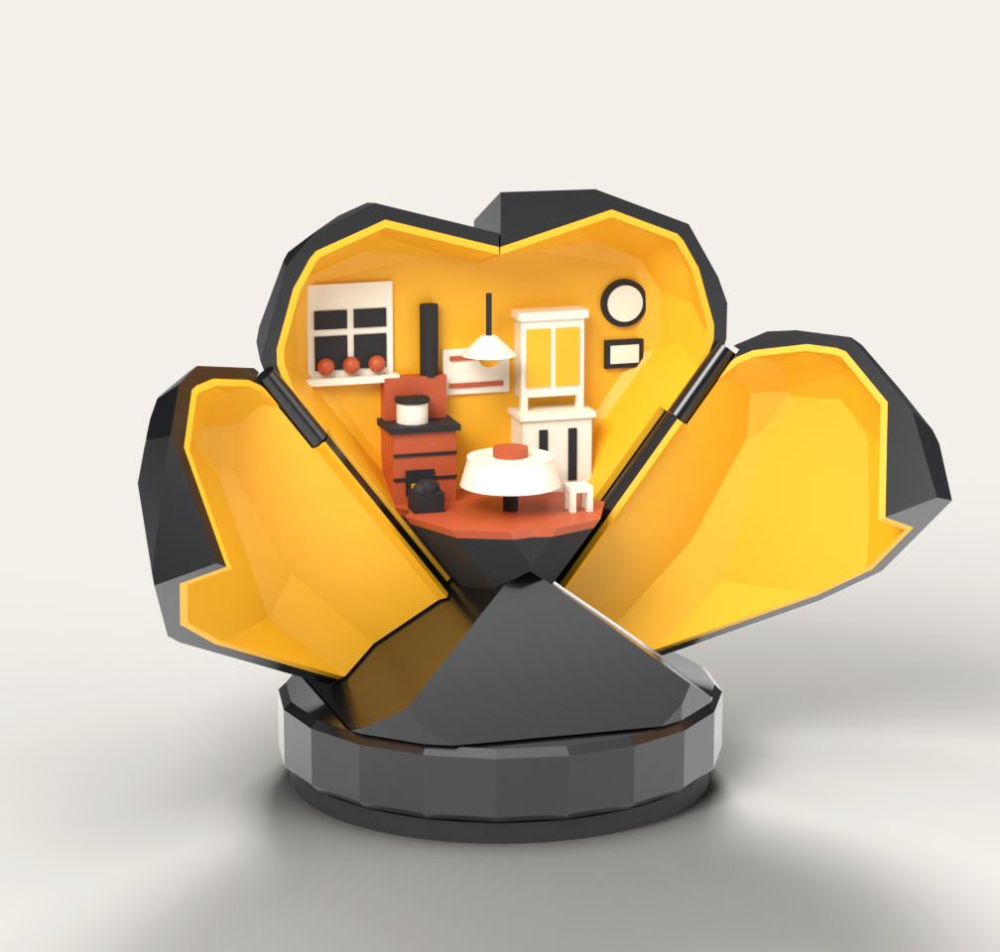 |

The back, closed: 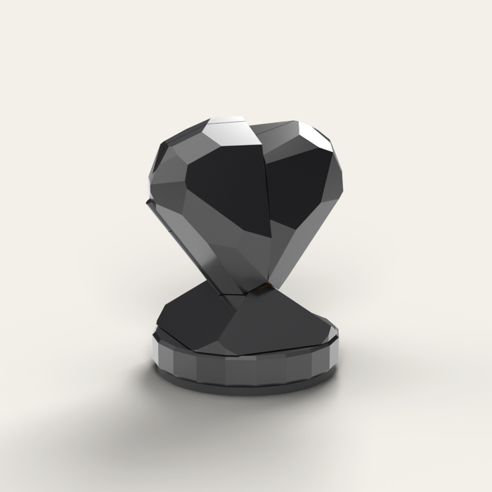

## 9. Three ways to open it

### A. Skrzydła (wings), recommended

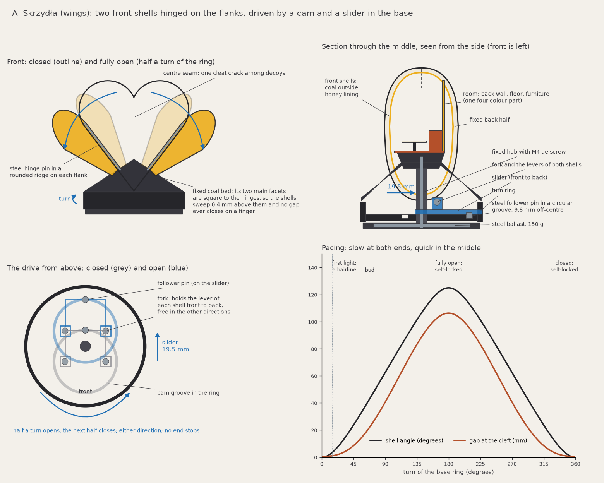

The heart is cut by the two seam planes into a fixed back half and two front quarters. Each
quarter is hinged on a steel pin that runs inside the rounded ridge of its flank, 37° from
vertical. A ring
in the base carries a circular groove set 9.8 mm off-centre. A slider follows the groove, moves
19.5 mm front to back, and swings both quarters together through 125°. Half a turn opens, the
next half closes, in either direction. The drive is at a dead point at both ends, so the shells
stay open or shut without a latch.

### B. Pokład (seam lift)

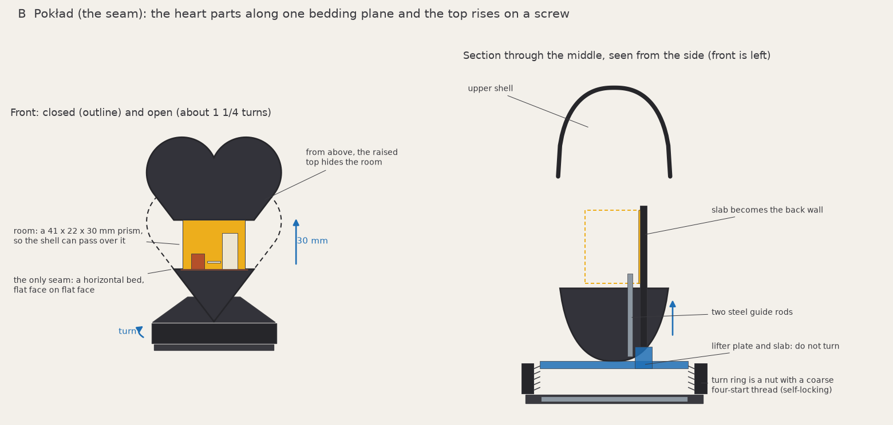
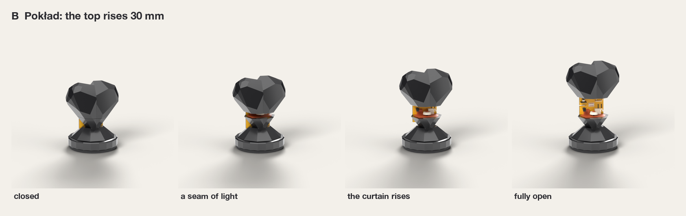

The heart parts along one horizontal bed and the upper part rises 30 mm on a coarse thread turned
by the ring, about one and a quarter turns. A slab at the back carries the top and becomes the
back wall. The room is a small block that the shell can pass over.

### C. Rozkwit (bloom)

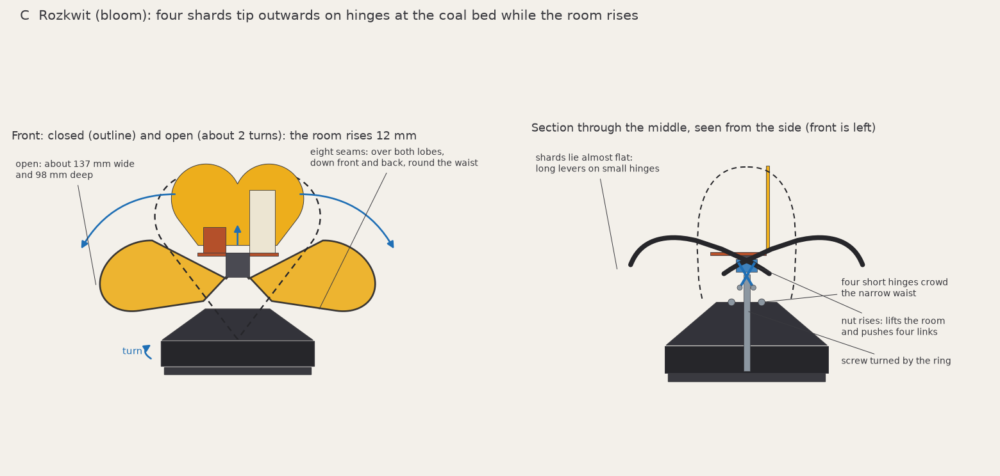
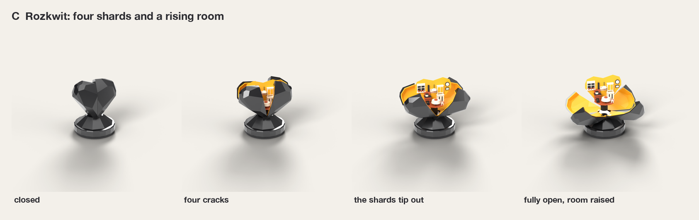

Four shards tip outwards on hinges at the waist while a screw raises the room 12 mm and pushes
four links, about two turns.

### Comparison

| | A Skrzydła | B Pokład | C Rozkwit |
|---|---|---|---|
| Closed: nothing hints | Two seam planes, read as cleat cracks, and a rounded ridge on each flank | **One horizontal seam** | Eight seams and a waist joint |
| One simple action | Half a turn | 1¼ turns | 2 turns |
| The reveal | A line of light, then a wedge, then the room framed by two wings | A band of light at the waist; the room is never framed | The most theatrical, but the heart falls apart |
| Open, from the front | Whole room, in a heart-shaped frame | Whole room, small | Whole room, raised |
| Open, from above (shop counter) | **Whole room in view** | The raised top hides the room | In view |
| Room size | **62 × 33 × 43 mm** | 41 × 22 × 30 mm, details below the print rules | As A, on a riser |
| What the open piece says | A heart with a home in it | A heart with its top lifted off | A broken heart: the wrong tone |
| Stays where left | Dead points at both ends; ring drag in between | Self-locking thread | Self-locking thread |
| Can be forced | No end stops to force | Stops at both ends of the thread | Stops, and long levers on small hinges |
| Mechanism hidden | Yes: only the hinge lines cross a visible surface | The lifting slab shows as a plain panel from the back when open | Links and riser show from above |
| Pinch points | Centre seam only; closing force limited by a spring and a clutch | The descending shell, all round | Four shards against the base |
| Open size | 133 × 79 × 102 mm | 84 × 77 × 134 mm, top-heavy | 137 × 98 × 106 mm |
| Printed parts | 9 to 11 | 9 | about 15 |
| Bought hardware | About 14 pieces of 8 kinds (below) | 2 guide rods, 1 screw and nut, ballast, feet | 4 hinge pins, 8 link pins, 1 screw and nut, ballast, feet |
| Assembly | About 10 minutes | About 8 minutes | 20 to 25 minutes |
| Print time per unit (estimate) | 16 h alone; 12 to 13 h in plates of four | 13 h | 15 h |
| Main risks | Play at the drive is magnified 3.7 to 8 times at the cleft; hinge life; whether the flank ridge reads as coal | Racking and rattle of the raised top; tiny interior | Seam fit, part count, fragile when open, wear in the links |

Print times are estimates from the volumes of the massing models (3 mm³/s on visible parts at
0.16 mm layers, 10 s per tool change), not slicer results; expect ±30% until the plates are
sliced. Tool changes cost a third to a half of the time on multi-colour plates and are shared
between all parts on a plate, which is why batches are faster. A run of 50 is about 26
printer-days.

**Why A:** it is the only option that can meet every experience goal in the brief. The room is
largest and is visible from the counter view; the open piece keeps the heart whole, which keeps
the tone affectionate; nothing can be forced; and the mechanism is hidden in both states. B fails
at the reveal and C fails at the closed form and at durability.

**Hardware for A, with reasons.** Two steel pins of 2 mm are the hinges: PLA pins of that size
would creep and snap. One 3 mm steel pin is the cam follower, the highest-wear contact. One M4
screw and nut tie the base together and let the unit be opened for service. One small steel
spring holds the shells shut (see below). One spring washer sets the drag of the ring. Standard
steel washers add about 150 g so the piece stays put while one hand turns the ring. Three
silicone feet stop it walking.

**How A will be built.** These are intentions for the motion proof to prove, not finished
engineering. The massing models do not show them.

1. **The hinge is a barrel on the flank.** A wing can only fold back 125° if its pivot lies close
   under the surface, so the pin sits 1.4 mm under the skin in a barrel of 2 mm radius that stands
   0.6 mm proud as the rounded ridge. It is held in the mound below and in a short fixed knuckle
   on the back half above, so the wing is carried along its whole flank.
   **The drive goes through the same line.** The barrel runs down into the mound as a root and
   carries the lever there. Nothing except the hinge line crosses a visible surface, so there are
   no slots to see when the shells are open.
2. **The seam faces set the closed position, not the drive.** The lever is 11 mm and the cleft is
   40 mm from the hinge, so 0.2 mm of play in the drive would be 0.7 to 1.6 mm at the seam. The shells
   therefore close against their own rims, and a steel spring in the slider holds them there. No
   PLA part is bent or stretched at rest, so nothing can creep in a warm window.
3. **The same spring gives way if something is caught in the seam,** and a slipping clutch in
   the ring limits the torque in both directions. Together they set how hard the seam can close
   on a finger and what happens when a shell is held and the ring is forced. Both limits will be
   measured in the motion proof.
4. **A soft detent at closed** keeps the ring home when the piece is picked up by its base.
5. **The cavity roof is a vault** no flatter than 40°, so the lining prints without supports, and
   the lining is at least 1.2 mm thick so the black does not show through.
6. **Service:** one screw from below releases the base; the hinge pins slide out.

## 10. Corrections to the earlier concept material

- The open size of C was labelled 190 mm. Measured on the model it is 137 × 98 mm. The diagram
  and the counter-view sheet are corrected.
- Labels in the three mechanism diagrams overlapped the drawings. They are moved clear.
- One market photo was filed as a coal heart on a stand; it shows a grave heart. It is renamed.
- **The wings overlapped the heart.** The client saw it in the pictures. Measured, each wing cut
  up to 972 mm³ into the fixed back half as it opened, because the hinge was drawn 3.2 mm inside
  the wall. The hinge is now the barrel described in section 9, the lining is 1.2 mm, and the
  model shows no overlap at any of 23 positions from closed to open. Every image in this brief
  was rendered again from the corrected model, so the heart's lower flanks look a little sharper
  than in the first version. The reasoning is in `design-notes.md`, section 3.
- Details in the massing models that break the rules in section 4 and will change: the pendant
  lamp on a 1 mm cord (becomes a wall bracket or goes), the stool's 1 mm legs, 0.5 mm tile
  grooves, and five facet slivers under 4 mm.

## 11. What I could not verify

- **Black filament.** No source shows matte, standard and silk black PLA side by side on a faceted
  print, and the filament guides I found disagree. I read them, including [23], only as search
  excerpts. The coal sample in the test prints decides.
- **Light colour over black.** The 1.2 mm rule is from general experience with multi-colour
  prints, not from a source. A step coupon in the test prints will measure it for your honey.
- **Tool-change time.** 5 s is the maker's figure [19]. A Tom's Hardware review is reported to
  give about 10 s including priming, but the page would not load for me. I used 10 s.
- **Heat.** PLA data sheets give a softening point of 55 to 60 °C (Polymaker and MatterHackers
  sheets, read only as search excerpts). A black part in direct sun behind glass can exceed that.
  The design keeps PLA unloaded, but only a heat soak of test parts will show whether standard PLA
  is enough or whether the black parts need a heat-resistant PLA grade.
- **Museum objects.** The museum's page names no objects; what I list from it is my reading of its
  photos [12][15].
- **Flower lamps** [18] and **Sadza Soap** (a coal-shaped soap at about 30 zł, the witty end of the
  market) are known to me only from search excerpts; the soap's guide page has been removed.
- **Market gap.** Searches found no opening or kinetic coal heart. The shops' shelves were not
  checked; worth one look in Katowice.
- **Rights.** The reference photos from the museum, Bonclok, Sand Atlas and the shops are other
  people's copyright. They are working references and must not be published.

## 12. Decisions (2026-11-13)

| Question | Decision |
|---|---|
| Look | 1 Bryła |
| Opening | A Skrzydła |
| Lining | Honey |
| Ballast | Yes, about 150 g of steel |
| Filament | Not final; probably the matte PLA colours of the report in `../blend/filaments`: Charcoal, Savannah Yellow, Desert Tan, Terracotta |
| Room | No figures, no religious objects |
| Edition number | A swappable tag under the foot |
| Price | Retail about 2 × cost with 25% off for the retailer; ideally 3 × cost |
| The earlier build | "The heart was just one box, with gaps. It simply was not reflecting the idea." So the motion proof uses the real faceted heart with hairline seams |

## 13. After approval

The work continues in stages, each ending with something you can check.

1. **Motion proof** (step 3 of the brief). `projects/serce` becomes a `cadkit` package. The
   shells and the whole drive are modelled as plain shapes with named parameters, swept through
   the full turn in both directions with collision and clearance checks as tests, and shown as a
   short animation and live in the OCP viewer.
2. **Test prints** (step 4). Hinge, drive and seam coupons; the coal sample in three blacks; one
   interior detail; the lining step coupon; a heat soak. Each comes with what to check and what to
   send back.
3. **Full design** (step 5). The decorated piece, every fit a parameter.
4. **Production package and marketing assets** (step 6). Plates for Snapmaker Orca, bill of
   materials, assembly guide, risk list, Blender scene, animation and stills.
