# Serce na węgiel: motion proof (step 3 of the brief)

2026-11-13. Model `serce` 0.2.0, variant `honey`. This is the bare moving system: the real
faceted Bryła heart split into its three shells, the hinges and the whole drive. Nothing is
decorated and the room is a stand-in. **It is a computer proof. Nothing has been printed yet.**

## 1. The result in short

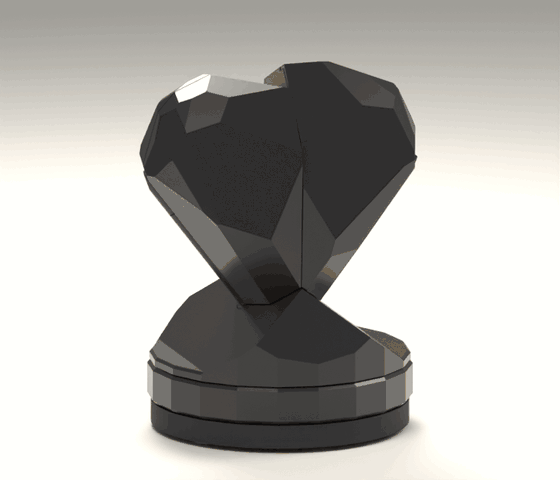

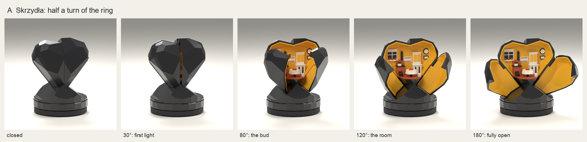

The brief asks this stage to show four things and to give you a short animation.

| The brief asks | Result |
|---|---|
| No parts collide | **None.** Exact overlap check of all 73 solids at 126 positions of a full turn, and along the path each part takes at assembly |
| The shell closes tight | **Yes.** The wings rest on the back half, held by a spring. The only lines are two grooves 0.3 mm wide with a closed black bottom. No gap wider than 0.3 mm anywhere |
| The effort stays even | **Yes, in the calculation.** 11 to 21 N mm while the wings move, up to 32 N mm on the last 23° of closing, never a step over 10 N mm. This is a model, not a measurement |
| The reveal reads as the look brief intends | **Yes.** Nothing shows closed. First light at about 30° of turn. The whole room is in view from 120° on |
| A short animation | Above: 72 frames, one full turn of the ring |

One further requirement of the brief is checked here as well: **the mechanism stays out of
sight**, closed, half open and open (section 3.5).

**What I need from you** is in section 6: six things to accept or reject, two open business
questions, and the go-ahead for the test prints.

| Closed | Open |
|---|---|
| 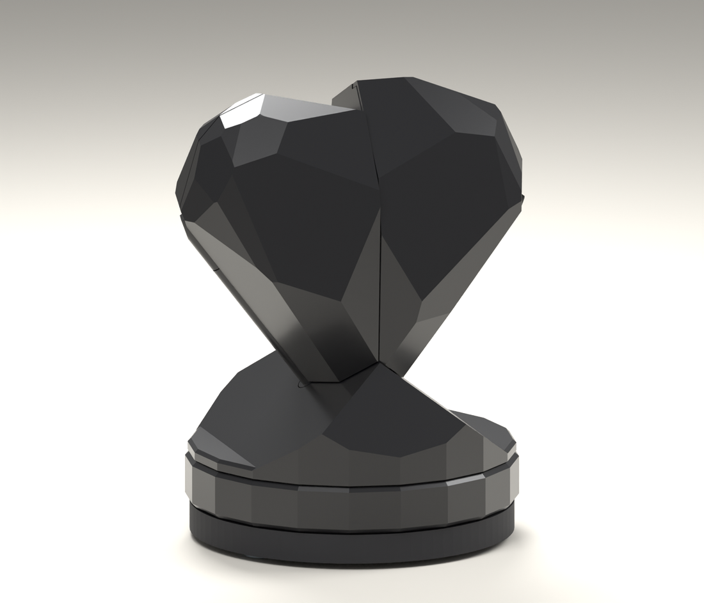 | 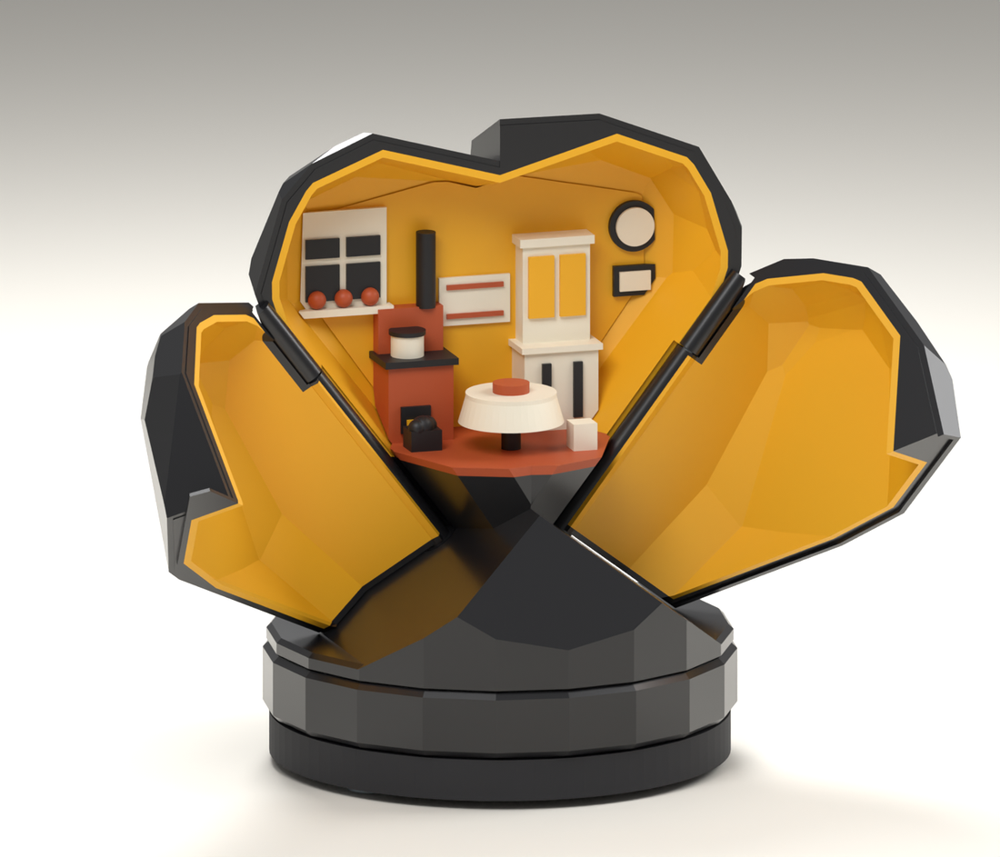 |

| From behind, closed | On a shop counter, open |
|---|---|
| 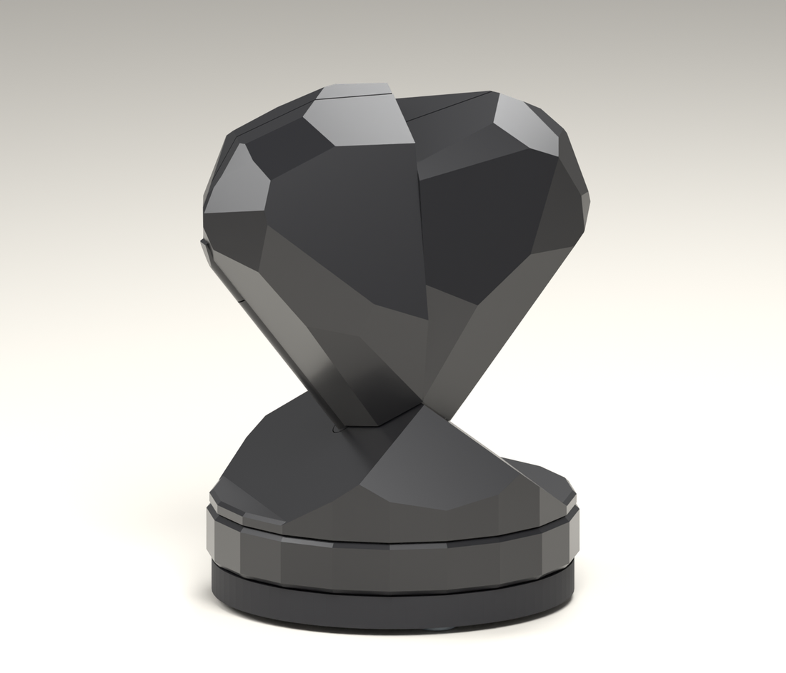 | 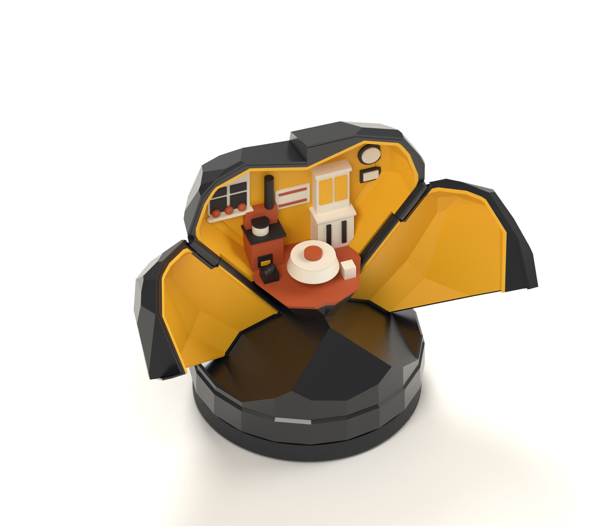 |

## 2. What was built

- **The shell** is the approved Bryła heart, cut by the two seam planes into a fixed back half
  and two wings. Each wing and the back half is one print in two colours: coal outside, honey
  lining inside.
- **Each wing turns on a 2 mm steel pin** that runs inside the rounded ridge of its flank. Below
  the coal bed the wing ends in a lever with a crank pin, all in one piece.
- **The drive is in the base.** The hand turns the grip ring. The ring carries a cam disc with a
  groove. A steel pin follows the groove and moves a slider 20.3 mm from front to back. The
  slider takes both crank pins with it, so both wings swing together through 125°.
- **Half a turn opens, the next half closes,** in either direction. At both ends the cam is at a
  dead point, so the wings cannot push the ring round and the piece stays as it is left.
- **A spring holds it shut.** When the wings reach their seats the slider goes on by 0.8 mm
  against a spring. Each wing is pressed shut with 12 N mm; gravity pulls on it with 1.8 N mm
  at most.
- **A magnetic clutch** couples the ring to the cam disc, so that forcing the ring, or a finger
  caught between the wings, makes it slip instead of breaking something.
- **About 140 g of steel** (one large washer) sits in the foot.

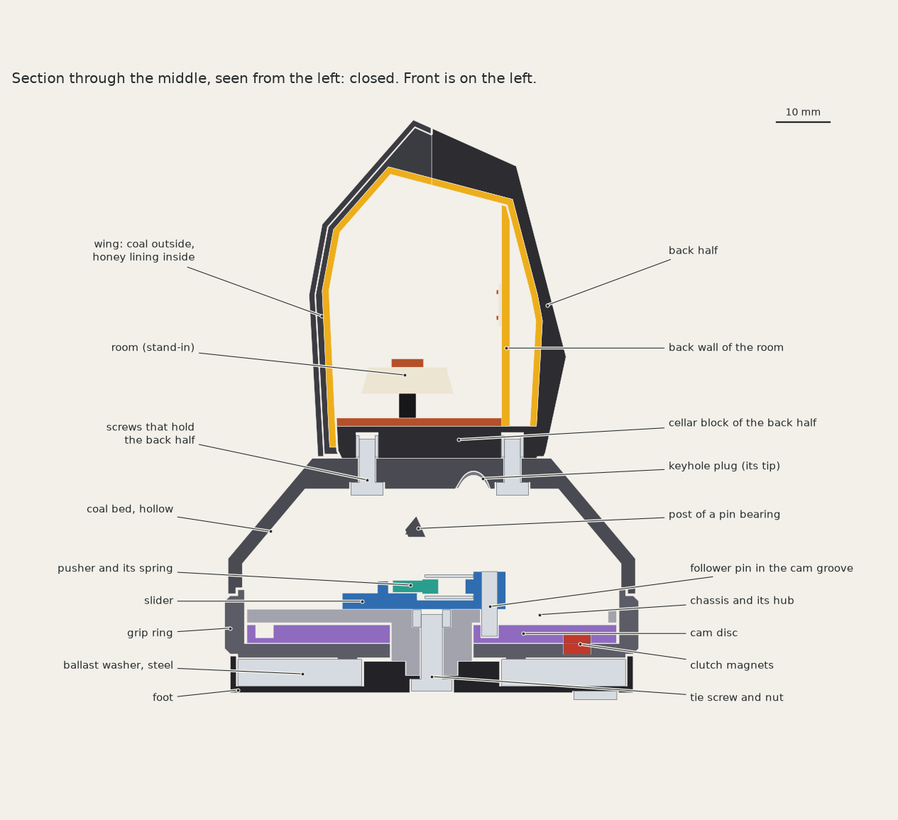

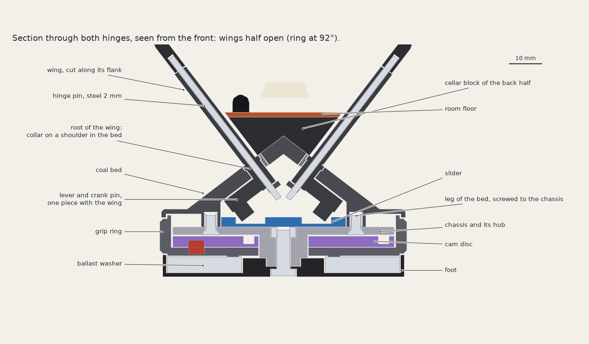

| The drive, with coal bed, ring and foot taken away | The cam under the slider |
|---|---|
| 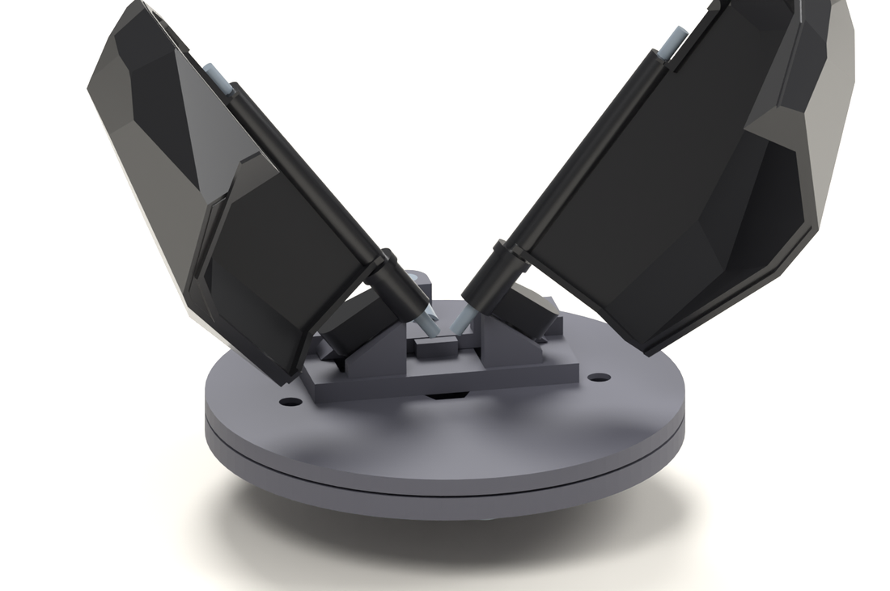 | 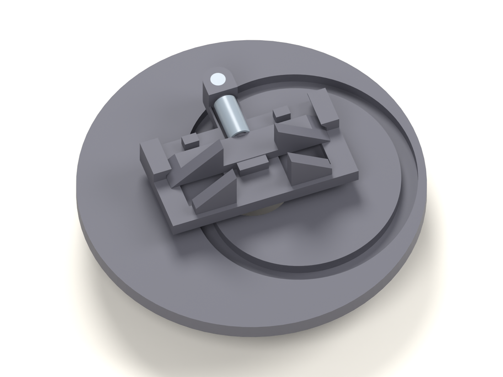 |

Hidden printed parts are grey in these pictures so that they can be read. They are black in
production.

| | |
|---|---|
| Size closed | 83.5 × 76.9 × 107.9 mm |
| Width open | 133.4 mm |
| Printed parts | 12: two wings, back half, coal bed, two keyhole plugs, slider, pusher, chassis, cam disc, grip ring, foot. The room comes on top in step 5 |
| Printed volume | 126 cm³ of the parts as solids, 156 g if printed solid; less with infill |
| Bought hardware | 24 pieces of 10 kinds: 2 hinge pins 2 × 55 mm, 1 follower pin 3 × 12 mm, 1 compression spring, 1 M4 screw and nut, 4 M3 screws and 4 heat-set inserts, 6 disc magnets 5 × 2 mm, 1 steel washer M24 (139 g), 3 silicone feet. Sizes are placeholders until the datasheets are checked |

## 3. The proofs

Everything in this section is a test in `projects/serce/tests`. Run `uv run pytest projects/serce`
(24 tests, about four and a half minutes, all pass). Nothing rests on looking at a picture.

### 3.1 Nothing collides

- Closed, no two of the 73 solids overlap.
- The ring is turned through 360° and the exact overlap volume of every moving part against
  every other part is computed at 126 positions: every 2.5° while the wings move, every 0.5°
  where they first leave their seats. All zero. Turning the other way passes the same positions.
- The assembly is checked the same way: the wing going down through its keyhole and swinging
  into its range, the back half sliding on from behind, the hinge pins going in from below.

### 3.2 It closes tight

| Where | Measured on the closed model |
|---|---|
| Wing against back half | In contact on the seam plane, coal on coal and lining on lining. This face sets the closed position |
| Groove at the seam between front and back | 0.3 mm wide, 1.0 mm deep, closed black bottom |
| Groove at the centre seam | 0.3 mm wide. Behind it one wing laps 0.6 mm under the other, so a look into the groove ends on coal |
| Wing to wing | 0.1 mm apart behind the groove. They never touch, so neither can hold the other off its seat |
| Wings above the coal bed | 0.3 mm |
| Hold | The spring is squeezed by 0.8 mm; 12.4 N mm on each wing against 1.8 N mm of gravity |

Closed, 47 viewers placed all round, above, and exactly along both seam planes see no point of
the room or of the linings.

### 3.3 The effort stays even

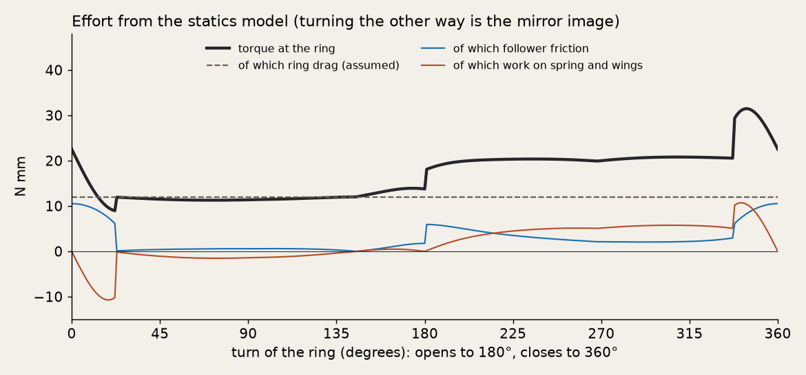

- Opening takes 11 to 14 N mm, closing 20 to 21 N mm. The difference is gravity: it helps the
  wings open and has to be overcome to close them.
- The last 23° of closing are firmer, up to 31.5 N mm: that is the spring being squeezed as the
  wings seat. It is the largest step in the curve, about 9 N mm.
- The torque never falls below 9 N mm, so the ring never runs on by itself.
- For scale: 20 N mm at the rim of the ring is the weight of about 55 g on a fingertip.

**How far to trust this.** It is a statics calculation with assumed friction (0.3 for PLA on
PLA, 0.2 for steel on PLA) and an assumed constant drag of the ring (12 N mm). It shows that the
mechanism adds little effort and adds it evenly. How heavy the ring feels in the hand is set
by the drag, which is chosen on the first prototype; a precious feel will want more of it than
is assumed here.

### 3.4 The reveal

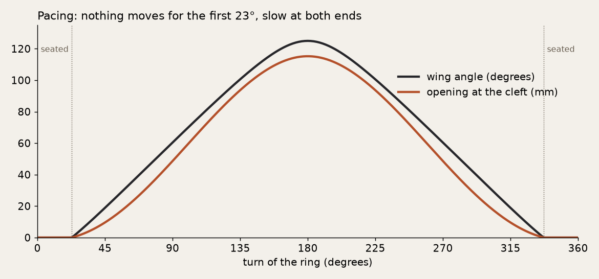

| Ring turned | Each wing | Opening at the cleft | Room in view from the front |
|---|---|---|---|
| 0° to 23° | 0° | closed | none |
| 30° | 6° | 2 mm | 6% |
| 40° | 15° | 7 mm | 20% |
| 60° | 33° | 20 mm | 51% |
| 80° | 51° | 39 mm | 83% |
| 100° | 70° | 59 mm | 98% |
| 120° | 88° | 80 mm | 100% |
| 180° | 125° | 115 mm | 100% |

"Room in view" is the share of the room's surface that a viewer in front, 10° above the
horizon, sees past the wings, by ray casting.

- **Closed:** a black heart on a mound of coal.
- **First light** at about 30°: a 2 mm line of honey down the middle. Nothing else has moved.
- **The bud** at 80°: the table and the stove show through a wedge.
- **The room** at 120°: all of it is in view between the wings.
- **Open** at 180°: the wings lie back beside the heart with their linings facing the viewer.
  Open, the room is in view to 100% from the front and from above a counter, and to 99.5% from
  45° to either side.
- The share in view never falls as the ring turns on. Slow at both ends, quick in the middle,
  as the look brief asks.

### 3.5 The mechanism stays hidden

- From the same 47 directions no point of the drive is seen: closed, at mid-swing and open.
  "The drive" is every printed part and every bought part inside the base and the bed, and all
  of each wing below the coal bed.
- **One defect was found and fixed in this stage.** With the wings open, one direction looked
  down the 0.2 mm running clearance round a wing's root, on through the keyhole that the lever
  passes at assembly, and reached the slider. Each keyhole now has a small plug (section 4).
- Because that was found by one viewer out of 47, I looked harder at the two roots: every
  direction within 60° of each hinge, 4° apart (687 directions a root), at points 0.8 mm apart
  on everything under the bed. Wings open: 27,586 points, none seen. Wings half open: 32,686
  points, none seen. As a control, the same check with the plugs taken out sees the slider
  again, down the left root. (`tools/root_sight.py`.)

## 4. What changed against the approved concept, and why

| Change | Why | What you see |
|---|---|---|
| The ridge of the coal bed runs the full depth of the heart | With the short ridge the heart overhangs the mound and leaves a wedge-shaped gap up to 9 mm high under its front. The short ridge also leaves no room for the drive: the slider hits the bed's end wall when open | Picture below. The mound is longer front to back |
| 4 mm taller: 108 mm | The steel washer needs 5 mm, and the clutch needs a floor in the grip ring | Within the brief's 100 mm ± 15% |
| A round hairline at the foot of each flank ridge | The wing's root needs a collar 6 mm across where it enters the bed. A root as thin as the ridge would be invisible, but would shear at about 200 N mm | A circle 6.4 mm across, 0.2 mm wide, about 1.8 mm outside the flank. Visible in the side view below |
| Nothing moves for the first 23° of turn | The spring's travel. It is what holds the piece shut when it is picked up by the ring | First light comes at about 30°, not at 15° as the look brief said |
| The last 23° of closing are firmer | The same spring | Section 3.3 |
| Two more printed parts: a plug in each assembly keyhole | To close the sight line of section 3.5. The plug is laid on the lever and goes in with the wing. It is then held by the wing and the back half: no glue, no press fit, no screw. It comes out again with the wing, so a wing can still be replaced | Nothing. One more step when a wing is put in |
| A pusher bar with one spring instead of a sprung shuttle | Each wing seats on its own. A rigid part pushing both would leave one wing short of its seat by the print tolerance, magnified eight times at the cleft | Nothing |

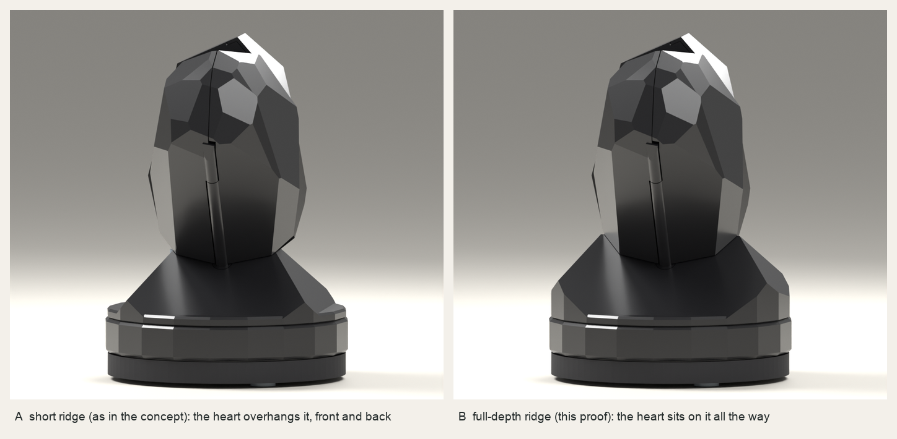

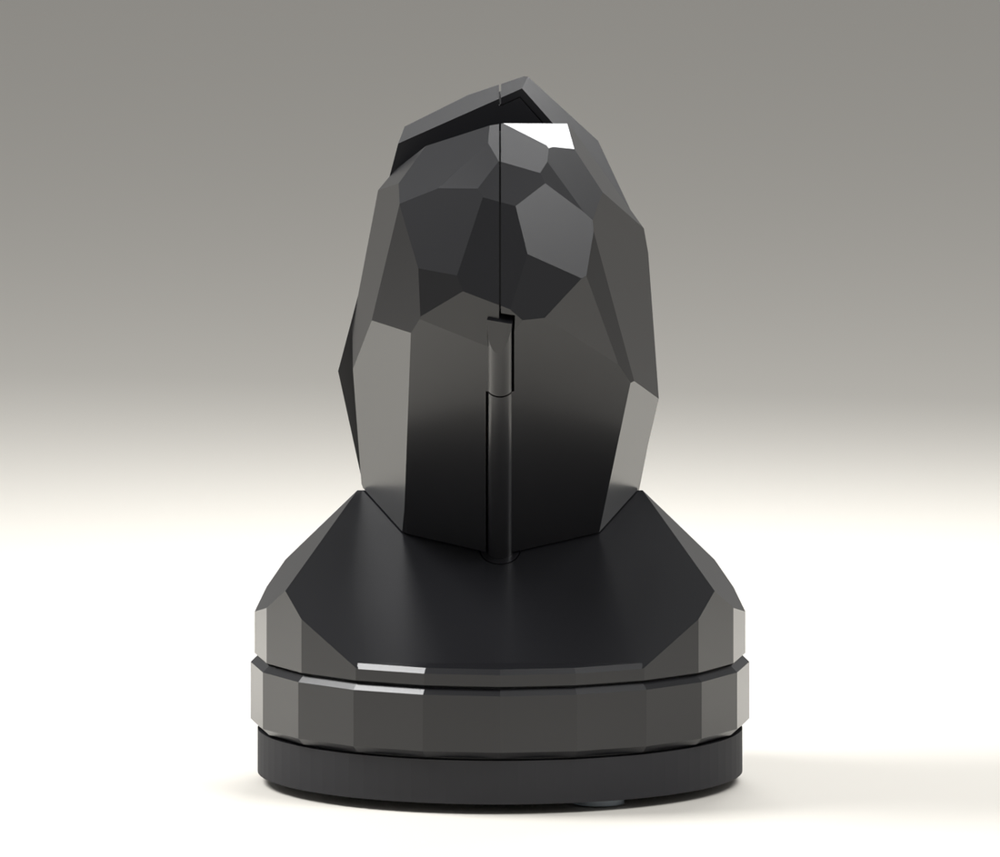

## 5. What this stage does not prove

These are for the test prints (step 4), which is why they come next.

- **Forces.** Friction, the spring (2.5 N preload, 3 N/mm assumed) and the ring's drag are
  assumptions. The feel is tuned on the prototype.
- **The clutch.** Three pairs of magnets, estimated to slip at 60 to 90 N mm. Not verified. The
  pinch force on a finger caught between the wings depends on it; the estimate is about 1 N
  per wing.
- **Strength.** The lever's neck is the weakest link: estimated 325 N mm, which is about 7 N at
  the wing's tip when a wing is forced by hand. A coupon has to measure it.
- **Print tolerance.** The 0.3 mm seam grooves, the 0.6 mm lap, the 0.3 mm hinge gap and the
  0.1 mm fit of the plugs all assume the printer holds them.
- **One limit of the plug.** Its own fit, 0.1 mm a side, is not covered by a step along one wall
  near the wing's root, because nothing that goes in from above can overlap there at a size a
  0.4 mm nozzle prints. If the print leaves a slit, it is about 0.1 × 0.4 mm, in line from one
  direction, with black parts behind it. The dense check above found nothing.
- **Printing.** A wing has its root and lever under its foot, so it prints on support under the
  foot, which is a hidden face. The hollow of the coal bed needs support inside.
- **Wear, heat and shipping:** 5,000 cycles, a warm shop window, a parcel.
- **Not modelled yet:** the real room, the false cracks and the surface, the facets on the
  hinge ridge (it is a plain cylinder here), the press fit of the hinge pin, the edition tag.

## 6. Questions for you

Please accept or reject each. Where you reject, I say what the alternative costs.

1. **The rounded ridge along each flank** (side view above). It is the hinge: 4 mm across,
   0.64 mm proud of the facets, ending in a short fixed piece under the lobe. This question is
   open since the concept. The alternative, a pivot exactly on the edge with no ridge, leaves
   the wing held by a weak joint at its foot only.
2. **The round hairline at the foot of each ridge.**
3. **The full-depth ridge of the coal bed** (picture B). Going back to A means a different
   drive.
4. **108 mm tall** instead of 104 mm.
5. **The idle first 23° of turn,** with first light at about 30°.
6. **The firmer last 23° of closing.**

Still open from before:

7. **Filament.** The four matte PLA colours of the filament report (Charcoal, Savannah Yellow,
   Desert Tan, Terracotta) are assumed. The coal sample in the test prints compares Charcoal
   with a standard and a glossy black.
8. **What "cost" includes** in the price rule: machine time, labour, rejects?

And:

9. **May I go on to the test prints** (step 4)?

## 7. How to look at it yourself

```
uv run pytest projects/serce                            # the proofs, about four and a half minutes
uv run cadkit show serce -v honey                       # the model in the OCP viewer, closed
uv run cadkit build serce -v honey --render --animate   # STEP, STL, 3MF, renders, the film
uv run python projects/serce/tools/motion_report.py     # the pictures and numbers of this page
uv run python projects/serce/tools/root_sight.py        # the dense check of 3.5
```

The build writes to `dist/serce/0.2.0/honey/`: `assembly.step`, one STL for each printed part,
`motion.gif`, `presentation.blend` and `manifest.json` with every parameter and file hash.
To pose the model in Python: `build(Params(turn=120))`.

## 8. Next

Step 4, the test prints: a hinge coupon, a root and lever coupon with its plug, a seam coupon,
the clutch, the coal sample in three blacks, the lining step, the vault, one interior detail,
and a heat soak. Each comes with what to check and what to send back.
